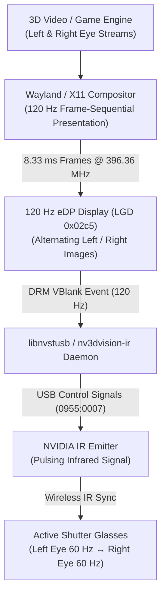

# 🕶️ NVIDIA 3D Vision on Linux: Hardware, Software & Stereoscopic 3D Guide (`3D_VISION.md`)

This document is the comprehensive hardware reference, protocol specification, and practical deployment guide for running **NVIDIA 3D Vision active-shutter glasses and infrared (IR) emitters** on Linux under the **Nouveau** driver, specifically focused on the **Dell XPS 17 L702X 3D Edition** (`GF106M` / 120 Hz eDP display + internal USB IR emitter) and external 3D Vision USB emitters (`0955:0007`).

---

## Table of Contents
1. [Hardware Architecture & Operating Principles](#1-hardware-architecture--operating-principles)
2. [Platform Topology: Dell XPS L702X 3D Vision Edition](#2-platform-topology-dell-xps-l702x-3d-vision-edition)
3. [The Open-Source Linux Software Stack](#3-the-open-source-linux-software-stack)
4. [Step-by-Step Setup Guide](#4-step-by-step-setup-guide)
5. [3D Video Playback with `bino` & `mpv`](#5-3d-video-playback-with-bino--mpv)
6. [Kodi Stereoscopic 3D Configuration](#6-kodi-stereoscopic-3d-configuration)
7. [OpenGL Quad-Buffered Stereo & Gaming](#7-opengl-quad-buffered-stereo--gaming)
8. [Implementation & Packaging Checklist for `nouveau-reclocking-dkms`](#8-implementation--packaging-checklist-for-nouveau-reclocking-dkms)

---

## 1. Hardware Architecture & Operating Principles

NVIDIA 3D Vision is an **active-shutter stereoscopic 3D system**. Instead of using passive polarized glasses (which halve vertical resolution on LCDs) or color-tinted anaglyph glasses, it delivers full-resolution 1080p to each eye by rapidly alternating left and right frames in sync with liquid-crystal shutter lenses.

### The Three Hardware Components
1. **The 120 Hz High-Refresh Display**:
   - The display panel runs at **120 Hz (specifically 119.97–120.00 Hz)**, displaying frames sequentially:
     `[Frame 1: Left Eye] → [Frame 2: Right Eye] → [Frame 3: Left Eye] → ...`
   - Each frame lasts exactly **`8.33 ms`** (`1 / 120 s`). Each eye perceives a flicker-free `60 Hz` progressive image.
2. **The USB Infrared Emitter (`USB ID 0955:0007` / `0955:7002`)**:
   - Built around a Cypress EZ-USB FX2 microcontroller (`CY7C68013A` or internal 8051).
   - On cold plug / boot, it reports USB ID **`0955:7002`** (uninitialized bootloader state). Once firmware is uploaded via USB control transfers, it re-enumerates as **`0955:0007`**.
   - Emits precisely timed wide-angle infrared pulses across the room to toggle and keep glasses synchronized.
3. **The Active-Shutter LCD Glasses**:
   - Lightweight battery-powered glasses with rapid twisted-nematic (TN) liquid-crystal lenses.
   - When the Left lens is transparent, the Right lens is opaque (black), and vice versa. An internal photodiode picks up the IR emitter pulses to synchronize transitions with vertical blanking (VBlank).



---

## 2. Platform Topology: Dell XPS L702X 3D Vision Edition

The Dell XPS 17 (L702X) 3D Vision SKU features a fully self-contained stereoscopic 3D setup:

| Subsystem | Hardware Specification | Linux / Nouveau Driver Status |
| :--- | :--- | :--- |
| **GPU** | NVIDIA GeForce GT 555M (`GF106M`, `10de:0dcd`) | Full reclocking (`v2.1.0` active at `900 MHz` DDR3) |
| **Internal Panel** | 17.3" 1920×1080 @ 120 Hz eDP (`LGD 0x02c5`, pixel clock `396.36 MHz`) | Active via `vblank_continuous=1` and `6 bpc` DP step-down |
| **IR Emitter** | Internal USB NVIDIA 3D Vision Emitter (hardwired to laptop USB hub) | Reports `0955:0007` (or `0955:7002` before firmware upload) |
| **Intel iGPU** | Intel HD Graphics 3000 (Sandy Bridge) | **Disabled in BIOS/ACPI**; discrete GT 555M drives 100% of scanout |

*(Because the Intel iGPU was physically incapable of the 396.36 MHz pixel clock, Dell permanently routed the display and internal emitter directly to the NVIDIA GPU.)*

---

## 3. The Open-Source Linux Software Stack

You do not need Windows or the discontinued proprietary NVIDIA 3D Vision driver to use your glasses. The protocol has been reverse-engineered and implemented in open source:

### 1. `libnvstusb` (The Reference Linux 3D Vision Driver)
- **Upstream Repository**: [github.com/vitalif/libnvstusb](https://github.com/vitalif/libnvstusb)
- **Features**:
  - Direct user-space USB communication via `libusb-1.0`.
  - Firmware extraction and cold-boot uploading into Cypress FX2 RAM.
  - Controls emitter operational states: standby, test mode, and active pulsing (lighting the built-in emitter status LED solid **emerald green**).
  - Configures eye timing offsets, pulse duration, and left/right toggle triggers.

### 2. `bino` (The Dedicated 3D Stereoscopic Media Player)
- **Website**: [bino3d.org](https://bino3d.org/)
- **Features**:
  - Full support for stereoscopic 3D formats: Side-by-Side (`SBS`), Top-and-Bottom (`TAB` / Over-Under), Half-SBS, and multi-stream 3D MKV.
  - Native **Alternating Frame-Sequential OpenGL Output** (compatible with 120 Hz displays).
  - Built-in integration with `libnvstusb` for synchronized shutter triggering.

### 3. `mpv` (Modern Media Player with OpenGL Stereo)
- High-performance video playback with built-in stereo conversion filters (`--vf=format=stereo3d=...`) and OpenGL stereo output.

---

## 4. Step-by-Step Setup Guide

### Step 1: Install Prerequisites
On Arch Linux / AliveOS / CachyOS:
```bash
sudo pacman -S base-devel git libusb cmake bino mpv
```

### Step 2: Build `libnvstusb`
```bash
git clone https://github.com/vitalif/libnvstusb.git
cd libnvstusb
make
```

### Step 3: Extract Emitter Firmware
The Cypress FX2 USB controller requires firmware (`nvstusb.fw`) extracted from the Windows driver (`nvstusb.sys`).
`libnvstusb` includes an automated extraction script:
```bash
# If you have nvstusb.sys from an official driver package:
python3 extract_fw.py nvstusb.sys nvstusb.fw

# Install the firmware and udev rules:
sudo cp nvstusb.fw /lib/firmware/
sudo cp udev/99-nvstusb.rules /etc/udev/rules.d/
sudo udevadm control --reload-rules && sudo udevadm trigger
```

### Step 4: Verify Emitter Hardware Communication
Run the diagnostic test:
```bash
sudo ./nvstusb-test
```
- **Expected Result**: The emitter LED on your laptop / external pyramid will change from dark/amber to **solid glowing emerald green**, and you will hear a faint microscopic oscillation if you hold the shutter glasses close to your ear—indicating active 60 Hz shutter flipping!

---

## 5. 3D Video Playback with `bino` & `mpv`

### Method A: Playback via `bino` (Native 3D Player)
1. Launch `bino`:
   ```bash
   bino -o stereo --stereo-mode=left-right 3d_movie_sample.mp4
   ```
2. In **Settings → Output**, select **Hardware Alternative (Page-Flip / Alternating Frames)**.
3. Put on your 3D Vision glasses, turn them on via the side button, and enjoy full 1080p stereoscopic 3D!

### Method B: Playback via `mpv`
`mpv` can convert Side-by-Side (SBS) or Top-Bottom (TAB) movies into alternating 120 Hz frames:
```bash
# For a Side-by-Side 3D movie on a 120Hz display:
mpv --vo=gpu --opengl-stereo=yes \
    --vf=stereo3d=sbsl:al \
    --vd-lavc-threads=4 \
    my_3d_movie.mkv
```
*(Option breakdown: `sbsl` = side-by-side left-eye first; `al` = alternating frames output at display refresh).*

---

## 6. Kodi Stereoscopic 3D Configuration

**Kodi (formerly XBMC)** has a dedicated stereoscopic 3D rendering pipeline integrated directly into its core player (`RenderManager`), allowing active shutter 3D playback on 120 Hz Linux setups.

### 1. Automatic 3D Flag Detection in Kodi
Kodi automatically detects stereoscopic 3D movies through file naming tags and MKV container metadata:
- `Movie.Name.3D.SBS.mkv` (Side-by-Side 3D)
- `Movie.Name.3D.TAB.mkv` (Top-and-Bottom / Over-Under)
- `Movie.Name.3D.MVC.mkv` (Multiview Video Coding / 3D Blu-ray MVC)

### 2. Native Kodi Settings for 120 Hz Active Shutter 3D
1. **Set Fullscreen 120 Hz Resolution**:
   - Navigate to **Settings → System → Display**:
     - **Display Mode**: `Full screen`
     - **Resolution**: `1920x1080`
     - **Refresh Rate**: `120.00 Hz` (or `119.98 Hz`)
2. **Configure 3D Playback Mode**:
   - Navigate to **Settings → Player → Videos → Stereoscopic 3D**:
     - **Playback mode of stereoscopic 3D videos**: Set to `Ask me` or `Preferred mode`.
     - **Stereoscopic 3D mode / Preferred mode**: Select **`Hardware based`** or **`Stereo / Anamorphic`**.
3. **Play 3D Content**:
   - When launching a 3D movie, Kodi prompts for the stereo mode. Select **`Hardware based`** (or **`Same as movie`** / **`Side by side`**).
   - Turn on your NVIDIA glasses. The lenses will alternate at 60 Hz per eye in sync with Kodi's 120 Hz frame output.

### 3. Alternative: Using Kodi with External `mpv` Stereo Player Core
If you prefer `mpv`'s specialized OpenGL stereo engine while browsing inside Kodi's 10-foot UI, configure an external player rule:

Create or edit `~/.kodi/userdata/playercorefactory.xml`:
```xml
<playercorefactory>
  <players>
    <player name="MPV-Stereo3D" type="ExternalPlayer" audio="false">
      <filename>/usr/bin/mpv</filename>
      <args>--fullscreen --vo=gpu --opengl-stereo=yes --vf=stereo3d=sbsl:al "{1}"</args>
      <hidexbmc>true</hidexbmc>
    </player>
  </players>
  <rules action="prepend">
    <rule filename=".*3D.*|.*SBS.*|.*TAB.*" player="MPV-Stereo3D"/>
  </rules>
</playercorefactory>
```
With this rule in place, clicking any 3D title in Kodi automatically launches `mpv` in 120 Hz alternating active-shutter mode and returns smoothly to Kodi upon exit.

---

## 7. OpenGL Quad-Buffered Stereo & Gaming

In classic workstation applications and Linux OpenGL games, stereoscopic rendering is requested via **Quad-Buffered Stereo** (`GLX_STEREO` / `EGL_STEREO`), which allocates four color buffers:
- `GL_FRONT_LEFT` & `GL_BACK_LEFT`
- `GL_FRONT_RIGHT` & `GL_BACK_RIGHT`

### How It Interacts with Nouveau
1. **DRM VBlank Synchronization**:
   - The user-space synchronization daemon (`nv3dvision-ir` or `libnvstusb`) listens to `drmWaitVBlank()` events on CRTC 0.
   - On each rising edge of vertical blanking, the daemon sends a rapid USB control transfer toggling the emitter's active eye.
2. **Wayland & X11 Compatibility**:
   - In X11, OpenGL quad-buffered stereo operates directly over DRI3.
   - In Wayland, alternating 120 Hz frame-sequential presentation is achieved via custom frame timing or Vulkan swapchains with alternating frame presentation.

---

## 7. Implementation & Packaging Checklist for `nouveau-reclocking-dkms`

To make 3D Vision a seamless, out-of-the-box feature on supported hardware:

- [ ] **Package `libnvstusb` in `aliveos-repo` / AUR**:
  - Package `libnvstusb` with automatic udev rules for `0955:0007` and `0955:7002`.
- [ ] **Build `nv3dvision-ir` Companion Service**:
  - Create a lightweight background systemd service (`nv3dvision-ir.service`) that automatically:
    1. Detects `0955:0007` USB device attachment.
    2. Uploads firmware if the device is in bootloader state `0955:7002`.
    3. Listens to DRM VBlank events when an application requests stereoscopic presentation.
- [ ] **Add 3D Vision Status Telemetry to `nouveau-ctrl` & `nouveau-tui`**:
  - Detect whether an internal or external 3D Vision IR emitter is present and display its state (`Active / Standby / Not Present`).
- [ ] **Document Display Quirk Integration (`TODO.md` §3)**:
  - Enforce the `dispclk >= 405 MHz` P-state floor (`P8`/`07` minimum) whenever 120 Hz 3D Vision mode is active, preventing display underruns during stereo playback.
