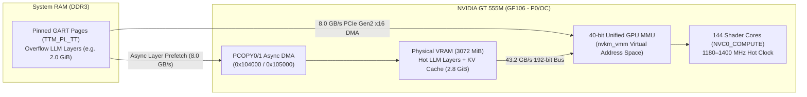

# 🧠 OpenCL 3.0, AI Inference & VRAM-as-System-RAM Architecture (`VRAM_AI.md`)

This document specifies the hardware capabilities, kernel mechanisms, and implementation roadmap for:
1. Unlocking **OpenCL 3.0 (`Mesa Rusticl`)** and **GPU-accelerated AI inference (`llama.cpp` / `ggml` / `CLBlast`)** on NVIDIA Fermi (`GF10x`/`GF11x`) and pre-`Nova` GPUs.
2. **Mode A (Unified Memory for AI Inference)**: Combining the **3072 MiB physical VRAM (`43.2 GB/s`)** with **pinned System RAM (`8.0 GB/s` PCIe Gen2 x16 GART)** in Fermi's 40-bit MMU so models larger than 3 GB (e.g., 7B–8B quantized LLMs) run on the GPU without `OUT_OF_MEMORY` failures.
3. **Mode B (Idle VRAM as Linux System RAM / `zram` Backing Store)**: Bypassing the 256 MiB PCI `BAR1` aperture limit by using Fermi's hardware **`PCOPY0`/`PCOPY1` async DMA engines (`0x104000` / `0x105000`)** to expose up to **2.5 GiB of upper VRAM** as an `8.0 GB/s` `blk-mq` RAM disk / `zram` backing store with automatic balloon eviction when 3D or AI apps need native VRAM.

---

## 1. Hardware Foundation (Dell XPS L702X — GeForce GT 555M `GF106M` / `10de:0dcd`)

With `nouveau-fermi-reclock` (`v2.0.1+`) active, the GT 555M provides hardware compute and memory resources that significantly exceed the host Sandy Bridge CPU's memory subsystem:

| Resource | Hardware Specification | Value for AI Inference & Memory Pooling |
|---|---|---|
| **Compute Engine** | `NVC0_COMPUTE` (class `0x90c0`), 3 SMs × 48 cores = **144 CUDA Cores** (`SM 2.1`) | **340 GFLOPS** FP32 at `0f` (`1180 MHz` shader) / **403.2 GFLOPS** FP32 at `10` (`1400 MHz` shader), plus native 32-bit integer `IMAD` for `Q4_0`/`Q4_K`/`Q8_0` quantized dot products |
| **Physical VRAM** | **3072 MiB (3.0 GiB)** DDR3 on a **192-bit** bus @ `900 MHz` (`1800 MT/s`) | **43.2 GB/s bandwidth** (**2.5× to 3× faster** than dual-channel DDR3-1333 laptop system RAM, which is the primary bottleneck for LLM `tok/s`) |
| **On-Chip Cache Hierarchy** | **48 KB L1 / Shared Local Memory (`__local`) per SM** + **512 KB `PLTCG` L2 Cache (`0x140000`)** | Enables fast tiled matrix multiplication (`GEMM` / `mul_mat_q4`) without redundant DRAM fetches |
| **GPU Virtual Memory (`nvkm_vmm`)** | **40-bit (`1 TB`) Unified Virtual Address Space** with 4 KB / 64 KB / 128 KB page tables | Shader instructions (`LD.E`, `ST.E`, `ATOM.E`) use true 64-bit pointers that can seamlessly address both physical VRAM (`TTM_PL_VRAM`) and system RAM (`TTM_PL_TT` / GART) |
| **Hardware Async DMA Engines** | **Dual Copy Engines**: `PCOPY0` (`0x104000`) & `PCOPY1` (`0x105000`, class `0x90b5`) | Transfers pages between System RAM and all 3072 MiB of VRAM at full **PCIe Gen2 x16 speed (`8.0 GB/s` per direction)** with zero CPU or 3D/Compute engine stalls |
| **PCI `BAR1` Aperture** | `256 MiB` CPU MMIO window (`0xf0000000`) | Only maps 256 MiB of VRAM for direct CPU MMIO reads (`< 500 MB/s`); **must be bypassed in favor of `PCOPY` DMA (`8.0 GB/s`) and GPU-side `NVC0_COMPUTE` (`43.2 GB/s`)** |

---

## 2. Part 1: Modern OpenCL 3.0 Support via Mesa `Rusticl`

### Why Legacy `Clover` Failed vs. Why `Rusticl` Succeeds
- Mesa's deprecated `Clover` state tracker only implemented OpenCL 1.1 via an incomplete LLVM/TGSI pipeline and lacked support for modern compute frameworks (`llama.cpp`, `CLBlast`, OBS OpenCL, Darktable).
- Mesa's modern **`Rusticl`** state tracker implements **OpenCL 3.0** by compiling OpenCL C $\to$ SPIR-V $\to$ **NIR** $\to$ **`nv50_ir` (`TargetNVC0`)**, targeting the exact same `NVC0_COMPUTE` (`0x90c0`) hardware engine that already runs OpenGL 4.3 `GL_ARB_compute_shader` on Fermi!

### Engineering Tasks to Make `Rusticl` First-Class on Fermi (`nvc0`)
1. **Unlock Full 3 GiB Tensor Allocations (`CL_DEVICE_MAX_MEM_ALLOC_SIZE`)**:
   - **Current Bottleneck**: In Mesa's `nvc0_screen.c` / `rusticl`, the maximum single buffer allocation defaults to `1/4` of VRAM (`768 MiB` on a 3 GiB card) or is capped by 32-bit texel buffer limits. When `llama.cpp` or `CLBlast` attempts to allocate a `1.5–2.6 GiB` weight buffer, OpenCL returns `CL_INVALID_BUFFER_SIZE`.
   - **Fix**: Because Fermi `NVC0_COMPUTE` accesses global buffers via 64-bit virtual addresses (`LD.E` / `ST.E`) rather than bound `TIC` texture buffers, raise `max_mem_alloc_size` / `max_global_size` on `nvc0` to **90% of VRAM (`~2.75 GiB`)**.
2. **Audit NIR $\to$ `nv50_ir` Compute Lowering for `Rusticl`**:
   - Verify that all NIR compute system values (`SYSTEM_VALUE_GLOBAL_INVOCATION_ID`, `LOCAL_INVOCATION_ID`, `WORKGROUP_ID`, `NUM_WORKGROUPS`), 64-bit pointer arithmetic, shared-memory (`__local`) barriers (`bar.sync 0`), and 32-bit/64-bit atomics lower cleanly in `nvc0_program.c` / `nv50_ir_from_nir.cpp`.
3. **Out-of-the-Box Environment Configuration**:
   - Ship `/etc/environment.d/50-nouveau-opencl.conf` (or profile hook) setting `RUSTICL_ENABLE=nouveau` once validated against `clinfo`, `CLBlast`, and `llama.cpp` (`ggml-opencl`).

---

## 3. Part 2: Mode A — Unified Virtual Memory (`VRAM + System RAM`) for Large AI Models

### Why Direction Matters: GPU-Reading-RAM (`8.0 GB/s`) vs. CPU-Reading-VRAM (`< 0.5 GB/s`)
A common misconception is trying to mount GPU VRAM via `slram` so the **CPU** can run AI inference on weights stored in VRAM. On PCIe GPUs, that is actually **10× slower** than system RAM because CPU reads across the PCIe `BAR1` aperture are uncached MMIO reads (`< 500 MB/s`) and can only see `256 MiB` of VRAM.

Instead, high-performance AI inference works in the opposite direction:
1. **The GPU (`NVC0_COMPUTE` @ `1180–1400 MHz`) executes the matrix multiplications (`GEMV`/`GEMM`).**
2. **Hot model layers (`up to ~2.8 GiB`) live in physical GPU VRAM** and are read by the Fermi shader cores at **`43.2 GB/s`**.
3. **Overflow model layers (when running a 4.5–6.0 GiB 7B/8B model)** live in **pinned System RAM (`TTM_PL_TT` / GART)** and are mapped into the **exact same 40-bit GPU virtual address space**, where the GPU fetches them over **PCIe Gen2 x16 DMA at `8.0 GB/s`** (or prefetches them into VRAM via `PCOPY` while the previous layer is computing!).

### Kernel & Userspace Implementation Tasks for Mode A
1. **Transparent `VRAM | GTT` Oversubscription in `nouveau_bo.c`**:
   - When a compute context allocates a buffer object (`NOUVEAU_GEM_DOMAIN_VRAM`) that exceeds free contiguous physical VRAM, allow automatic placement fallback to `TTM_PL_VRAM | TTM_PL_TT` (`NOUVEAU_GEM_DOMAIN_VRAM | NOUVEAU_GEM_DOMAIN_GART`) instead of returning `-ENOMEM`.
   - In `nouveau_uvmm.c` (`VM_BIND`), map both VRAM-backed and GART-backed BOs into the channel's 40-bit virtual address space so the shader sees a seamless 64-bit pointer space across all `3 GiB VRAM + System RAM`.
2. **Async `PCOPY` Double-Buffered Layer Prefetching (Advanced Optimization)**:
   - Because Fermi has **two independent hardware DMA copy engines (`PCOPY0` `0x104000` and `PCOPY1` `0x105000`)** that run concurrently with `NVC0_COMPUTE` (`0x90c0`), an inference backend can keep `2.5 GiB` of static layers in VRAM and use `PCOPY0` to stream the remaining System-RAM layers into a `256 MiB` VRAM ring buffer in the background while the shaders compute the current layer—hiding PCIe latency behind compute!

---

## 4. Part 3: Mode B — Exposing Idle GPU VRAM as Linux System RAM / `zram` Backing Store (`nouveau-vram-bdev`)

When the GPU is **not** running a heavy 3D game or large LLM (for example, during software compilation, heavy browser multitasking, or CPU data processing), ~`2.5 GiB` of the GT 555M's `3072 MiB` VRAM sits completely unused.

### Why Traditional `slram` / `mtdram` Does Not Work on Fermi
- Tools like `modprobe slram map=VRAM,0xf0000000,+256M` map the PCI `BAR1` physical address range directly into the host CPU.
- On Fermi (`GF106`), `BAR1` is only a **256 MiB window**, leaving the remaining **2816 MiB (`2.75 GiB`) of VRAM completely unreachable** to `slram`, and CPU MMIO reads over `BAR1` stall the CPU pipeline.

### Our Solution: A `PCOPY` DMA-Backed `blk-mq` Device (`/dev/nvram0`) Using All 3072 MiB
Because our kernel driver (`nouveau.ko`) controls the GPU's internal memory manager (`TTM_PL_VRAM`) and its **`PCOPY0`/`PCOPY1` (`0x104000`/`0x105000`) hardware DMA engines**, it can access **all `3072 MiB` of VRAM** without touching `BAR1`:

1. **Upper-VRAM Allocation (`offset > 512 MiB`)**:
   - Allocate a configurable pool (e.g., `2048 MiB`–`2560 MiB`) from the **top of physical VRAM** (`TTM_PL_VRAM` top-down placement), leaving the lower `512 MiB` (and the `256 MiB` `BAR1` window) completely free for the 120 Hz display framebuffer and desktop compositor.
2. **Hardware `PCOPY` DMA Transfers (`8.0 GB/s`, Zero CPU Copy)**:
   - Register a lightweight Linux `blk-mq` block device (`/dev/nvram0`) inside `nouveau`.
   - When Linux reads or writes a 4 KB page (or 64 KB cluster) to `/dev/nvram0`, the driver maps the kernel `bio` page to a transient IOMMU/DMA address and pushes a 16-byte DMA copy command to **`PCOPY1` (`0x105000`)**:
     - **Write (RAM $\to$ VRAM)**: `PCOPY1` DMAs the page over PCIe Gen2 x16 at **`8.0 GB/s`** into upper VRAM and fires a completion interrupt.
     - **Read (VRAM $\to$ RAM)**: `PCOPY1` DMAs the page from upper VRAM back into the host `bio` page at **`8.0 GB/s`** (16× faster than `BAR1` CPU MMIO reads!).
3. **Pairing with Linux `zram` (`zram` Writeback + High-Priority Swap)**:
   - Configure `/dev/nvram0` either as the **`zram` backing device** (`/sys/block/zram0/backing_dev`) or as a `pri=32767` ultra-fast swap tier above SSD swap.
4. **Automatic Balloon Eviction When 3D / AI Workloads Launch**:
   - If a 3D game or OpenCL AI model requests native VRAM (`nouveau_bo_new` in `TTM_PL_VRAM`) and free VRAM drops below a threshold (e.g., `256 MiB`), `nouveau` can automatically shrink the `/dev/nvram0` pool—migrating swapped pages back to system RAM via `PCOPY`—so GPU applications always get the full `3072 MiB` of VRAM on demand!

---

## 5. Summary Implementation Checklist

- [ ] **Phase 1 — OpenCL 3.0 (`Rusticl`) & Full 3 GiB Allocations**:
  - Raise `nvc0` maximum single-buffer allocation size to `~2.75 GiB` and validate `RUSTICL_ENABLE=nouveau` with `clinfo`, `CLBlast`, and `llama.cpp` (`GGML_OPENCL=1`).
- [ ] **Phase 2 — Mode A: Unified `VRAM + GART` Oversubscription for AI**:
  - Enable seamless `TTM_PL_VRAM | TTM_PL_TT` fallback for compute buffer objects in `nouveau_bo.c` so `> 3 GiB` models spill over into `8.0 GB/s` PCIe Gen2 pinned system RAM without `ENOMEM`.
- [ ] **Phase 3 — Mode B: `/dev/nvram0` `PCOPY` DMA Block Device (`NvVramSwap`)**:
  - Implement optional `NvVramSwap=<MiB>` module parameter creating `/dev/nvram0` backed by upper VRAM (`TTM_PL_VRAM`) and `PCOPY1` (`0x105000`) async DMA, with [`nouveau-ctrl`](file:///home/twilight/Projects/nouveau-fermi-reclock-dkms/nouveau-ctrl) / [`nouveau-tui`](file:///home/twilight/Projects/nouveau-fermi-reclock-dkms/nouveau-tui) telemetry and dynamic balloon eviction.
