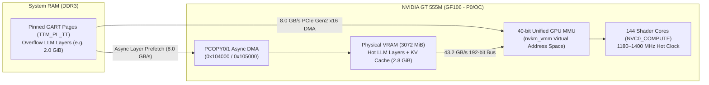
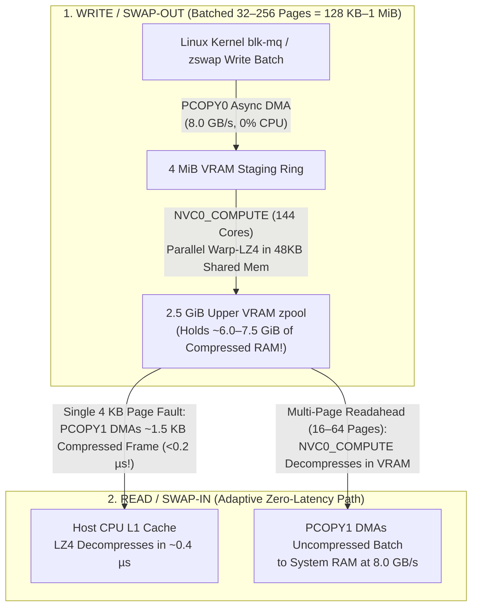

# 🧠 OpenCL 3.0, Local AI Inference & VRAM-as-System-RAM Architecture (`VRAM_AI.md`)

This document is the unified reference and implementation specification for **OpenCL 3.0 compute (`Mesa Rusticl`)**, **Local LLM / SLM AI Inference (`llama.cpp` / `CLBlast`)**, **Unified `VRAM + GART` Memory Pooling**, and **GPU-Accelerated VRAM Swap (`nvzram`)** on NVIDIA Fermi (`GF10x`/`GF11x`) and pre-`Nova` GPUs under the **Nouveau** driver.

---

## Table of Contents
1. [Hardware Compute & Memory Foundation (`GF106M` / GT 555M 3 GB)](#1-hardware-compute--memory-foundation-gf106m--gt-555m-3-gb)
2. [The LLM Memory-Bandwidth Equation & Recommended SLMs](#2-the-llm-memory-bandwidth-equation--recommended-slms)
3. [Part 1: Modern OpenCL 3.0 Support via Mesa `Rusticl`](#3-part-1-modern-opencl-30-support-via-mesa-rusticl)
4. [Practical Deployment Guide: Running `llama.cpp` Today](#4-practical-deployment-guide-running-llamacpp-today)
5. [Part 2: Mode A — Unified Virtual Memory (`VRAM + System RAM`) for `> 3 GiB` AI Models](#5-part-2-mode-a--unified-virtual-memory-vram--system-ram-for--3-gib-ai-models)
6. [Part 3: Mode B — Exposing Idle GPU VRAM as Linux System RAM (`/dev/nvram0`)](#6-part-3-mode-b--exposing-idle-gpu-vram-as-linux-system-ram-devnvram0)
7. [Part 4: GPU-Accelerated `nvzram` (`PCOPY` + `NVC0_COMPUTE` Warp-LZ4 in VRAM)](#7-part-4-gpu-accelerated-nvzram-pcopy--nvc0_compute-warp-lz4-in-vram)
8. [Implementation Checklist](#8-implementation-checklist)

---

## 1. Hardware Compute & Memory Foundation (`GF106M` / GT 555M 3 GB)

With `nouveau-fermi-reclock` (`v2.1.0+`) active on the Dell XPS L702X (`10de:0dcd`), the GeForce GT 555M provides compute and memory resources that significantly outpace the host 2nd-Gen Intel Core i7-2630QM CPU's DDR3-1333 memory controller:

| Resource | Hardware Specification | Value for AI Inference & Memory Pooling |
| :--- | :--- | :--- |
| **Compute Engine** | `NVC0_COMPUTE` (class `0x90c0`), 3 SMs × 48 cores = **144 CUDA Cores** (`SM 2.1`) | **339.8 GFLOPS** FP32 at `0f` (`1180 MHz` shader) / **403.2 GFLOPS** FP32 at `10` (`1400 MHz` shader), plus native 32-bit integer `IMAD` for `Q4_0`/`Q4_K`/`Q8_0` quantized dot products |
| **Physical VRAM** | **3072 MiB (3.0 GiB)** DDR3 on a **192-bit** crossbar bus @ `900 MHz` (`1800 MT/s`) | **43.2 GB/s peak bandwidth** (~`41.3 GB/s` net after 120 Hz display scanout; `~2.5–2.6 GiB` net usable VRAM) |
| **On-Chip Cache Hierarchy** | **48 KB L1 / Shared Local Memory (`__local`) per SM** + **384–512 KB `PLTCG` L2 Cache (`0x140000`)** | Enables fast tiled matrix multiplication (`GEMM` / `mul_mat_q4`) without redundant DRAM fetches |
| **GPU Virtual Memory (`nvkm_vmm`)** | **40-bit (`1 TB`) Unified Virtual Address Space** with 4 KB / 64 KB / 128 KB page tables | Shader instructions (`LD.E`, `ST.E`, `ATOM.E`) use true 64-bit pointers that seamlessly address both physical VRAM (`TTM_PL_VRAM`) and system RAM (`TTM_PL_TT` / GART) |
| **Hardware Async DMA Engines** | **Dual Copy Engines**: `PCOPY0` (`0x104000`, class `0x90b5`) & `PCOPY1` (`0x105000`, class `0x90b8`) | Transfers pages between System RAM and all 3072 MiB of VRAM at full **PCIe Gen2 x16 speed (`8.0 GB/s` per direction)** with zero CPU or 3D/Compute engine stalls |
| **PCI `BAR1` Aperture** | `256 MiB` CPU MMIO window (`0xf0000000`) | Only maps 256 MiB of VRAM for direct CPU MMIO reads (`< 500 MB/s`); **bypassed in favor of `PCOPY` DMA (`8.0 GB/s`) and GPU-side `NVC0_COMPUTE` (`43.2 GB/s`)** |

---

## 2. The LLM Memory-Bandwidth Equation & Recommended SLMs

While **training** and **prompt pre-fill** are compute-bound (`GEMM`), **single-user autoregressive token generation** is almost exclusively **memory-bandwidth bound** (`GEMV`). Every generated token requires reading the active model weights from memory once:

```text
Max Generation Speed (tokens/sec) ≈ Memory Bandwidth (GB/s) / Model Weight Size in VRAM (GB)
```

| Model Weight Size in VRAM | Theoretical Ceiling (`43.2 GB/s`) | Realistic Throughput (25%–35% Bus Efficiency) |
| :---: | :---: | :---: |
| **400 MB** (`0.5B Q4`) | ~108 tokens/sec | **25–35 tokens/sec** |
| **800 MB** (`1.0B Q4`) | ~54 tokens/sec | **14–18 tokens/sec** |
| **1.1 GB** (`1.5B Q4`) | ~39 tokens/sec | **10–13 tokens/sec** |
| **1.5 GB** (`2.0B Q4`) | ~28 tokens/sec | **7–10 tokens/sec** |

*(Human reading speed is ~4–5 tokens/sec; 8–18 tokens/sec is fluid and responsive for interactive local chat and coding assistance.)*

### Recommended Small Language Models (SLMs) Fitting Entirely in 3 GB VRAM

| Model Name | Parameters | Quantization | Weight Size | Total VRAM (w/ 2K Context) | Strengths |
| :--- | :---: | :---: | :---: | :---: | :--- |
| **Qwen 2.5 0.5B Instruct** | 0.5B | `Q4_K_M` / `Q8_0` | ~395–550 MB | ~650–820 MB | Blazing speed, instruction following, multilingual |
| **Llama 3.2 1B Instruct** | 1.2B | `Q4_K_M` | ~750 MB | ~1.15 GB | Strong summarization, general chat, and tool use |
| **SmolLM2 1.7B Instruct** | 1.7B | `Q4_K_M` | ~1.05 GB | ~1.55 GB | Trained on 11T tokens; strong coding and math for its class |
| **Qwen 2.5 1.5B Instruct** | 1.5B | `Q4_K_M` | ~1.12 GB | ~1.60 GB | Top-tier 1.5B reasoning, logic, and multi-turn dialogue |
| **Gemma 2 2B Instruct** | 2.6B | `Q3_K_M` | ~1.45 GB | ~2.10 GB | High accuracy when context window is kept `<= 2048` |

---

## 3. Part 1: Modern OpenCL 3.0 Support via Mesa `Rusticl`

### Why Legacy `Clover` Failed vs. Why `Rusticl` Succeeds
- Mesa's deprecated `Clover` state tracker only implemented OpenCL 1.1 via an incomplete LLVM/TGSI pipeline and lacked support for modern compute frameworks (`llama.cpp`, `CLBlast`, OBS OpenCL, Darktable).
- Mesa's modern **`Rusticl`** state tracker implements **OpenCL 3.0** by compiling OpenCL C → SPIR-V → **NIR** → **`nv50_ir` (`TargetNVC0`)**, targeting the exact same `NVC0_COMPUTE` (`0x90c0`) hardware engine that already runs OpenGL 4.3 `GL_ARB_compute_shader` on Fermi.

### Engineering Tasks to Make `Rusticl` First-Class on Fermi (`nvc0`)
1. **Unlock Full 3 GiB Tensor Allocations (`CL_DEVICE_MAX_MEM_ALLOC_SIZE`)**:
   - **Current Bottleneck**: In Mesa's `nvc0_screen.c` / `rusticl`, the maximum single buffer allocation defaults to `1/4` of VRAM (`768 MiB` on a 3 GiB card). When `llama.cpp` or `CLBlast` attempts to allocate a `1.5–2.6 GiB` weight buffer, OpenCL returns `CL_INVALID_BUFFER_SIZE`.
   - **Fix**: Because Fermi `NVC0_COMPUTE` accesses global buffers via 64-bit virtual addresses (`LD.E` / `ST.E`) rather than bound `TIC` texture buffers, raise `max_mem_alloc_size` / `max_global_size` on `nvc0` to **90% of VRAM (`~2.75 GiB`)**.
2. **Audit NIR → `nv50_ir` Compute Lowering for `Rusticl`**:
   - Verify that all NIR compute system values (`SYSTEM_VALUE_GLOBAL_INVOCATION_ID`, `LOCAL_INVOCATION_ID`, `WORKGROUP_ID`, `NUM_WORKGROUPS`), 64-bit pointer arithmetic, shared-memory (`__local`) barriers (`bar.sync 0`), and 32-bit/64-bit atomics lower cleanly in `nvc0_program.c` / `nv50_ir_from_nir.cpp`.
3. **Out-of-the-Box Environment Configuration**:
   - Ship `/etc/environment.d/50-nouveau-opencl.conf` setting `RUSTICL_ENABLE=nouveau` once validated against `clinfo`, `CLBlast`, and `llama.cpp` (`ggml-opencl`).

---

## 4. Practical Deployment Guide: Running `llama.cpp` Today

### 1. Install OpenCL & Build Dependencies
```bash
sudo pacman -S base-devel git cmake opencl-mesa ocl-icd opencl-headers clinfo curl
RUSTICL_ENABLE=nouveau clinfo
```

### 2. Build `llama.cpp` with the OpenCL (`CLBlast`) Backend
```bash
git clone https://github.com/ggerganov/llama.cpp
cd llama.cpp
cmake -B build \
  -DGGML_OPENCL=ON \
  -DGGML_OPENCL_EMBED_KERNELS=ON \
  -DCMAKE_BUILD_TYPE=Release
cmake --build build --config Release -j$(nproc)
```

### 3. Download a GGUF Model & Run on the GPU
```bash
mkdir -p ~/models && cd ~/models
curl -L -o llama-3.2-1b-instruct-q4_k_m.gguf \
  "https://huggingface.co/bartowski/Llama-3.2-1B-Instruct-GGUF/resolve/main/Llama-3.2-1B-Instruct-Q4_K_M.gguf"

# Lock GPU to P0 (0f) or OC (10) during sustained inference, then run:
nouveau-ctrl set 0f
RUSTICL_ENABLE=nouveau ~/llama.cpp/build/bin/llama-cli \
  -m ~/models/llama-3.2-1b-instruct-q4_k_m.gguf \
  -ngl 99 -c 2048 -co --color
```
*(For 3B–7B models prior to Mode A kernel oversubscription, adjust `-ngl <layers>` to split layers between the GT 555M and the Core i7-2630QM AVX CPU.)*

---

## 5. Part 2: Mode A — Unified Virtual Memory (`VRAM + System RAM`) for `> 3 GiB` AI Models

### Why Direction Matters: GPU-Reading-RAM (`8.0 GB/s`) vs. CPU-Reading-VRAM (`< 0.5 GB/s`)
Mounting GPU VRAM via `slram` so the **CPU** can run AI inference on weights stored in VRAM is **10× slower** than system RAM because CPU reads across the PCIe `BAR1` aperture are uncached MMIO reads (`< 500 MB/s`) and can only see `256 MiB` of VRAM.

High-performance AI inference works in the opposite direction:
1. **The GPU (`NVC0_COMPUTE` @ `1180–1400 MHz`) executes the matrix multiplications (`GEMV`/`GEMM`).**
2. **Hot model layers (`up to ~2.8 GiB`) live in physical GPU VRAM** and are read by the Fermi shader cores at **`43.2 GB/s`**.
3. **Overflow model layers (when running a 4.5–6.0 GiB 7B/8B model)** live in **pinned System RAM (`TTM_PL_TT` / GART)** and are mapped into the **exact same 40-bit GPU virtual address space**, where the GPU fetches them over **PCIe Gen2 x16 DMA at `8.0 GB/s`** (or prefetches them into VRAM via `PCOPY` while the previous layer is computing).



### Kernel & Userspace Implementation Tasks for Mode A
1. **Transparent `VRAM | GTT` Oversubscription in `nouveau_bo.c`**:
   - When a compute context allocates a buffer object (`NOUVEAU_GEM_DOMAIN_VRAM`) that exceeds free contiguous physical VRAM, allow automatic placement fallback to `TTM_PL_VRAM | TTM_PL_TT` (`NOUVEAU_GEM_DOMAIN_VRAM | NOUVEAU_GEM_DOMAIN_GART`) instead of returning `-ENOMEM`.
   - In `nouveau_uvmm.c` (`VM_BIND`), map both VRAM-backed and GART-backed BOs into the channel's 40-bit virtual address space so the shader sees a seamless 64-bit pointer space across all `3 GiB VRAM + System RAM`.
2. **Async `PCOPY` Double-Buffered Layer Prefetching**:
   - Keep `2.5 GiB` of static layers in VRAM and use `PCOPY0` (`0x104000`) to stream the remaining System-RAM layers into a `256 MiB` VRAM ring buffer in the background while the shaders compute the current layer—hiding PCIe latency behind compute.

---

## 6. Part 3: Mode B — Exposing Idle GPU VRAM as Linux System RAM (`/dev/nvram0`)

When the GPU is **not** running a heavy 3D game or large LLM, ~`2.5 GiB` of the GT 555M's `3072 MiB` VRAM sits completely unused. Because `BAR1` is only a `256 MiB` window, `slram` cannot reach the upper `2.75 GiB` of VRAM.

### Solution: A `PCOPY` DMA-Backed `blk-mq` Device (`/dev/nvram0`) Using All 3072 MiB
Because `nouveau.ko` controls the GPU's internal memory manager (`TTM_PL_VRAM`) and its **`PCOPY0`/`PCOPY1` (`0x104000`/`0x105000`) hardware DMA engines**, it can access **all `3072 MiB` of VRAM** without touching `BAR1`:
1. **Upper-VRAM Allocation (`offset > 512 MiB`)**:
   - Allocate a configurable pool (`2048–2560 MiB`) from the **top of physical VRAM** (`TTM_PL_VRAM` top-down placement), leaving the lower `512 MiB` (and the `256 MiB` `BAR1` window) free for the 120 Hz display framebuffer and desktop compositor.
2. **Hardware `PCOPY` DMA Transfers (`8.0 GB/s`, Zero CPU Copy)**:
   - Register a Linux `blk-mq` block device (`/dev/nvram0`) inside `nouveau`.
   - Map incoming `bio` pages to transient IOMMU/DMA addresses and push 16-byte DMA copy commands to **`PCOPY1` (`0x105000`)** (`8.0 GB/s` RAM ↔ VRAM, 16× faster than `BAR1` CPU MMIO reads).
3. **Automatic Balloon Eviction When 3D / AI Workloads Launch**:
   - When a 3D game or OpenCL AI model requests native VRAM (`TTM_PL_VRAM`) and free VRAM drops below `256 MiB`, automatically shrink `/dev/nvram0`—migrating swapped pages back to system RAM via `PCOPY`—so GPU applications always get the full `3072 MiB` of VRAM on demand.

---

## 7. Part 4: GPU-Accelerated `nvzram` (`PCOPY` + `NVC0_COMPUTE` Warp-LZ4 in VRAM)

Going one step further than an uncompressed VRAM block device: **the GPU itself can perform `zram` compression inside VRAM so the CPU spends zero cycles compressing memory during swap storms, multiplying the effective capacity of the `2.5 GiB` VRAM pool to `~6.0–7.5 GiB`.**

### 1. Hardware Engine: `NVC0_COMPUTE` (`0x90c0`) + `48 KB` On-Chip SM Shared Memory
- Using a pre-compiled **`SM20` Warp-Parallel `LZ4` (`GPU-LZ4`)** micro-kernel loaded by the kernel driver, each 32-thread warp loads a `4 KB` page into its 48 KB on-chip Shared Memory, performs parallel hash-table match finding across 32 bytes per clock, and writes the compressed `~1.3–1.8 KB` payload **directly into the `2.5 GiB` Upper VRAM `zpool` at `43.2 GB/s` internal VRAM speed**.

### 2. Asymmetric "Batch-Compress on GPU / Adaptive-Decompress on Read" Pipeline
Linux swap traffic is asymmetric: **Swap-Out (Writes)** happens in large batches (`swap_cluster_max`, 32–256 pages = `128 KB–1 MiB`), whereas **Swap-In (Reads)** is either a **single 4 KB page fault** or a **16–64 page readahead cluster**.



1. **On Write (`Swap-Out` Batch of 32–256 Pages — 0% CPU Overhead)**:
   - `PCOPY0` (`0x104000`) DMAs the raw 4 KB pages from System RAM into a `4 MiB` VRAM staging ring at `8.0 GB/s`.
   - `NVC0_COMPUTE` (`0x90c0`) launches 1 warp per page across all 144 cores, compressing all 32–256 pages simultaneously inside VRAM (`43.2 GB/s`) into the `2.5 GiB` Upper VRAM `zpool`.
2. **On Single-Page Read (`Swap-In` Page Fault — Faster Than Uncompressed PCIe DMA)**:
   - Instead of waiting `~5–8 µs` to launch a GPU compute shader for a single page, **`PCOPY1` (`0x105000`) DMAs the still-compressed `~1.5 KB` frame** directly to the host CPU (`< 0.2 µs`, 2.7× faster transfer over PCIe!), and the host CPU decompresses it in L1 cache in `~0.4 µs` (`~0.6 µs` total, equivalent to **`~20+ GB/s` effective PCIe swap-in bandwidth**).
3. **On Multi-Page Readahead (`16–64 Pages`)**:
   - `NVC0_COMPUTE` decompresses all pages in parallel inside VRAM and `PCOPY1` DMAs the decompressed cluster to System RAM.

---

## 8. Implementation Checklist

- [ ] **Phase 1 — OpenCL 3.0 (`Rusticl`) & Full 3 GiB Allocations**:
  - Raise `nvc0` maximum single-buffer allocation size to `~2.75 GiB` and validate `RUSTICL_ENABLE=nouveau` with `clinfo`, `CLBlast`, and `llama.cpp` (`GGML_OPENCL=1`).
- [ ] **Phase 2 — Mode A: Unified `VRAM + GART` Oversubscription for AI**:
  - Enable seamless `TTM_PL_VRAM | TTM_PL_TT` fallback for compute buffer objects in `nouveau_bo.c` so `> 3 GiB` models spill over into `8.0 GB/s` PCIe Gen2 pinned system RAM without `ENOMEM`.
- [ ] **Phase 3 — Mode B: `/dev/nvram0` `PCOPY` DMA Block Device (`NvVramSwap`)**:
  - Implement optional `NvVramSwap=<MiB>` module parameter creating `/dev/nvram0` backed by upper VRAM (`TTM_PL_VRAM`) and `PCOPY1` (`0x105000`) async DMA, with [`nouveau-ctrl`](file:///home/twilight/Projects/nouveau-fermi-reclock-dkms/nouveau-ctrl) / [`nouveau-tui`](file:///home/twilight/Projects/nouveau-fermi-reclock-dkms/nouveau-tui) telemetry and dynamic balloon eviction.
- [ ] **Phase 4 — GPU-Accelerated `nvzram` (`PCOPY` + `NVC0_COMPUTE` Warp-LZ4)**:
  - Add batched `SM20` Warp-LZ4 compute compression in VRAM (`4 MiB` staging ring → `2.5 GiB` upper-VRAM `zpool`, storing `~6.0–7.5 GiB` of compressed system RAM) paired with adaptive compressed-DMA single-page `swapin`.
