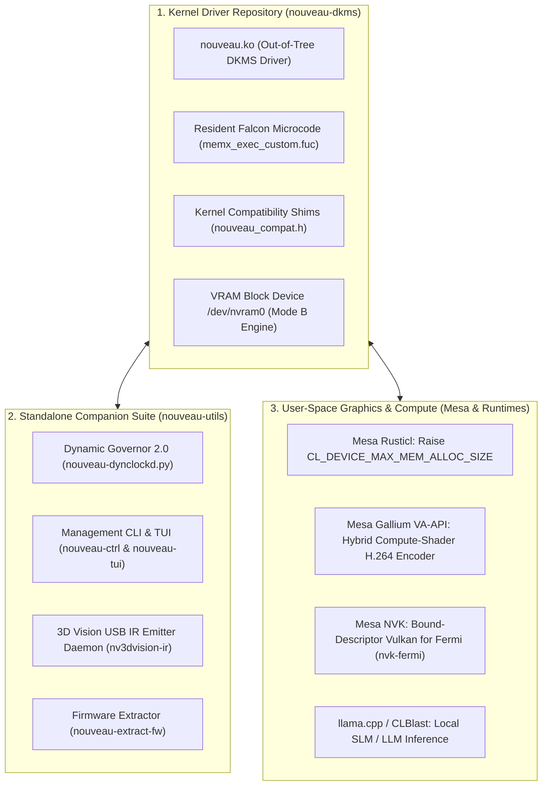

# 🧭 Features Architectural Breakdown & Project Separation Checklist (`FEATURES_BREAKDOWN_CHECKLIST.md`)

This document outlines the architectural boundaries of all planned and in-flight features across the project. It classifies which components belong directly inside the **kernel driver (`nouveau.ko`)**, which must be maintained in **upstream user-space projects (e.g. Mesa)**, and which belong in a **companion user-space utilities suite**.

It also documents the distribution and maintenance strategy for upstream components when upstream acceptance is uncertain.

---

## Table of Contents
1. [Architectural Overview & Separation Blueprint](#1-architectural-overview--separation-blueprint)
2. [Category 1: Inside the Kernel Driver (`nouveau.ko` / `nouveau-dkms`)](#2-category-1-inside-the-kernel-driver-nouveauko--nouveau-dkms)
3. [Category 2: Upstream User-Space Projects (Mesa, Compilers, Runtimes)](#3-category-2-upstream-user-space-projects-mesa-compilers-runtimes)
4. [Category 3: Companion User-Space Utilities Suite (`nouveau-utils`)](#4-category-3-companion-user-space-utilities-suite-nouveau-utils)
5. [Upstream Strategy: Benefiting from Changes Without Upstream Approval](#5-upstream-strategy-benefiting-from-changes-without-upstream-approval)
6. [Master Implementation Checklist](#6-master-implementation-checklist)

---

## 1. Architectural Overview & Separation Blueprint

---

## 2. Category 1: Inside the Kernel Driver (`nouveau.ko` / `nouveau-dkms`)

These items require direct MMIO register access, hardware interrupt servicing, physical DRAM controller management, or kernel DRM subsystem hooks.

### 1. Reclocking & Clock State Management
- [x] **Bidirectional DDR3 Memory Reclocking (`324 MHz` ↔ `900 MHz`)**: Resident Falcon microcode executor (`memx_exec_custom.fuc` / `fexec_code.inc`) via `SCRATCH2`/`SCRATCH3` mailboxes.
- [x] **Zero-Stutter Signed-`vpos` VBlank-Onset Memory Reclocking (`v2.2.0`)**:
  - True NV50/GF100 signed-`vpos` calculation in `ramgf100.c` (`gf100_ram_calc_vpos` / `gf100_ram_wait_vblank`), stepping in 80–150 µs sleeps into the approach zone, tight-polling `udelay(1)` for VBlank onset (`vpos 1077 -> -46`), and completing host PHY latch (`0x001548`) in 477–535 µs inside VBlank without visual stutter.
- [x] **Boot-Time Resident Falcon Pre-Warm (`gf100_ram_calc_ddr3`)**: Pre-warms the resident executor at initial 324 MHz boot initialization so runtime transitions run on the sub-millisecond fast-path without cold resets.
- [x] **S3 Suspend / Resume Self-Healing**: Hardware signature check (`SCRATCH0 == 0xE1EC0001`) and cold fallback path.
- [x] **Dynamic PCIe Gen1 (`2.5 GT/s`) ↔ Gen2 (`5.0 GT/s`) Link Retraining**: Automatic retraining via `0x02241c`, `0x088460`, and `0x088088`.
- [x] **P-State 10 Overclock (`708/1416/900 MHz @ 1.030 V`)**: Gated behind `config=NvFermiOC=true`.
- [ ] **Synthetic P3 State `0a` (`405/810/650 MHz @ 0.920 V`)**:
  - `0x132004 = 0x10012702` MEMPLL formula + VBIOS strap selection + VID `0x03` voltage mapping.
- [ ] **Hardware Parity Optimization: Lossless Z-Cull & Tile Depth Compression (`TAGRAM` / `PLTCG` `0x140000` / `PGRAPH`) [~15% Bandwidth Win]**:
  - Audit and decompile `_nv010721rm` / `_nv031754rm` and Mesa `nv50_surface.c` to enable Z-Cull and ROP color tile compression tags, cutting 3D rasterization bus pressure by 30–50% to close the ~15% bandwidth parity gap.
- [ ] **Fine-Grained BLCG / SLCG Hardware Clock Gating (`0x00020xxx`)**:
  - Extract `.rodata` tables from `nv-kernel.o_binary` and program them during `gr`/`fb`/`therm` init, cutting idle leakage by `2–4 W` and providing dynamic power/thermal headroom.
- [ ] **Pre-`Nova` Architecture Expansion**:
  - Tesla (`GT215`), Fermi (`GF100–GF119`), Kepler (`GK104–GK208`), and First-Gen Maxwell (`GM107`/`GM108` unsigned Falcon).

### 2. Display Engine & Modesetting (`dispnv50`)
- [x] **120 Hz Display Floor Guard (`v2.2.0`)**:
  - Clamps `idle_floor` to `07` (`405 MHz` `dispclk`) when `pixel_clock > 135 MHz` (120 Hz) via `libdrm.so.2` CRTC interrogation, matching `390.157` IMP checks (`_nv002187kms`) to eliminate FIFO underflows.
- [ ] **120 Hz eDP DP Link Validation & Auto BPC Step-Down**:
  - Connector atomic check stepping down `8 bpc` (`24 bpp` = 9.51 Gbps) → **`6 bpc` (`18 bpp` = 7.13 Gbps)** with hardware dithering to fit 4-lane HBR1 (8.64 Gbps max).
- [ ] **EDID `+5.0 MHz` Grace Margin & Stereo Quirk**:
  - Bypass conflicting EDID range caps on 3D Vision panels (`LGD 0x02c5`).
- [ ] **Atomic KMS Async Page-Flip (`DRM_MODE_PAGE_FLIP_ASYNC`) & Explicit Sync**:
  - Allow low-latency presentation in games above 120 FPS and validate `linux-drm-syncobj-v1` timeline fences.

### 3. Hardware Telemetry & Thermal Protection
- [x] **In-Kernel TTM VRAM Accounting (`v2.1.0`)**: Exact `VRAM: <used> MiB / <total> MiB used` in debugfs `pstate`.
- [x] **Hardware Interrupt Activity Tracking (`v2.2.0`)**: Sub-millisecond GPU load tracking via `/proc/interrupts` (`nvkm`).
- [ ] **PDAEMON Hardware Engine Utilization Counters**:
  - Configure signal filters in `0x10a600..0x10a610` to measure true hardware `GR %`, `FB %`, and `VDEC %` load.
- [ ] **Standard DRM `fdinfo` (`drm_show_fdinfo`)**:
  - Expose per-process engine and VRAM usage for `nvtop`, `btop`, and `MangoHud`.
- [ ] **Unprivileged sysfs Telemetry**:
  - Expose `gpu_busy_percent` and `mem_info_vram_*` under `/sys/class/drm/card*/device/`.
- [ ] **Hardware `PTHERM` Auto-Slowdown**:
  - Configure hardware thermal clock dividers at `90–92 °C` as an unkillable safety floor with progressive multi-step governor throttling (`10` → `0f` → `0a` → `07`).

### 4. Memory Subsystem Extensions
- [ ] **Mode A (Kernel Layer)**:
  - Transparent `TTM_PL_VRAM | TTM_PL_TT` oversubscription fallback in `nouveau_bo.c` and 40-bit UVMM address mapping for `> 3 GiB` models.
- [ ] **Mode B (`/dev/nvram0`)**:
  - `PCOPY` DMA-backed `blk-mq` block device driver exposing upper VRAM with dynamic balloon eviction.

### 5. Out-of-Tree Maintenance Infrastructure
- [x] **Kernel 6.18.55 Rebase Compatibility**: Version-guarded `drm_client_dev_suspend/resume`.
- [ ] **Multi-Kernel Compatibility Header (`nouveau_compat.h`)**: Centralize kernel API compatibility wrappers.
- [ ] **Multi-Kernel GitHub Actions CI Matrix**: Automated compile checks across CachyOS, Arch, and LTS kernels.

---

## 3. Category 2: Upstream User-Space Projects (Mesa, Compilers, Runtimes)

These components live above the kernel interface. They compile against user-space graphics APIs and cannot be included directly in `nouveau.ko`.

### 1. Mesa Gallium (`nvc0` / Rusticl / VA-API)
- [ ] **Mesa Rusticl: Raise `CL_DEVICE_MAX_MEM_ALLOC_SIZE`**:
  - **Location**: `src/gallium/drivers/nouveau/nvc0/` in Mesa.
  - **Action**: Raise single buffer allocation cap from 25% of VRAM (`768 MiB`) to **90% of VRAM (`~2.75 GiB`)** so `llama.cpp` and `CLBlast` can load weights into contiguous buffers.
- [ ] **Mesa Gallium VA-API: Hybrid Compute-Shader H.264 Encoder**:
  - **Location**: `src/gallium/frontends/va/` and `src/gallium/drivers/nouveau/nvc0/`.
  - **Action**: Implement `pipe_video_codec` with `VAEntrypointEncSlice` running color conversion, parallel SAD/SATD motion estimation, and integer DCT on Fermi SMs (`NVC0_COMPUTE`), outputting to standard OBS Studio (`obs-vaapi`) and FFmpeg.
- [ ] **Mesa Gallium VA-API: Kepler/Maxwell Fixed-Function `MSENC` (`0x1c8000`)**:
  - **Location**: `src/gallium/drivers/nouveau/nve4/` and `nv50/`.
  - **Action**: Expose hardware `NVENC` via VA-API on Kepler (`GK104+`) and Maxwell (`GM107+`).

### 2. Mesa Vulkan (`NVK` / `nvk-fermi`)
- [ ] **Vulkan 1.0/1.1 Bound-Descriptor Lowering (`nvk-fermi`)**:
  - **Location**: `src/nouveau/vulkan/` in Mesa.
  - **Action**: Implement `hasvk`-style bound-descriptor lowering (mapping Vulkan descriptor sets into Fermi's 128 `TIC` / 32 `TSC` binding tables) over Mesa's `NIR → nv50_ir` compiler backend.

### 3. Mesa Gallium & Compiler Backends (`nv50_ir` / `nouveau`)
- [ ] **Mesa `nv50_ir`: Dual-Issue Warp Scheduling & Superscalar Dispatch [~10% Compute Win]**:
  - **Location**: `src/nouveau/codegen/nv50_ir_*.cpp` in Mesa.
  - **Action**: Enhance instruction scheduler to bundle independent ALU + TEX/MEM or INT + FP instructions into dual-issue pairs for Fermi SM20 dual warp schedulers, closing the shader ALU deficit against NVIDIA's proprietary compiler.
- [ ] **Mesa `nv50_ir`: Register Spilling Mitigation & Constant Rematerialization**:
  - **Location**: `src/nouveau/codegen/nv50_ir_ra.cpp` in Mesa.
  - **Action**: Implement graph-coloring rematerialization of uniform expressions, constants, and address math during register allocation to prevent spills into slow local VRAM.
- [ ] **Mesa Gallium Z-Cull & Tile Compression Integration**:
  - **Location**: `src/gallium/drivers/nouveau/nv50/nv50_surface.c` and `nvc0/`.
  - **Action**: Bind kernel `TAGRAM` buffer allocations to depth/stencil surfaces to activate hardware Z-Cull and lossless color tile compression.

### 4. Application Runtimes & Inference Engines
- [ ] **`llama.cpp` / `CLBlast` OpenCL Acceleration**:
  - Build and tune `llama.cpp` with `-DGGML_OPENCL=ON` for Small Language Models (SLMs) on Fermi.

---

## 4. Category 3: Companion User-Space Utilities Suite (`nouveau-utils`)

These tools reside in user space. They have been officially decoupled into a standalone repository ([Twilight0/nouveau-utils](https://github.com/Twilight0/nouveau-utils)) with independent releases and multi-distro packaging:

### 1. Codebase Separation & Packaging
- [x] **Repository Decoupling**: Standalone git repository `Twilight0/nouveau-utils` with complete commit/tag history preserved via `git-filter-repo`.
- [x] **Cross-Distribution Packaging**: Dedicated `Makefile`, Arch Linux `PKGBUILD` + `.SRCINFO`, Debian/Ubuntu (`packaging/debian/`), and Fedora/RHEL (`packaging/rpm/nouveau-utils.spec`).
- [x] **Distribution Channels**: Published to the Arch User Repository ([`nouveau-utils` on AUR](https://aur.archlinux.org/packages/nouveau-utils)), GitHub Releases (`v2.2.1`), and the `aliveos-repo`.

### 2. Daemon & Power Management
- [x] **`nouveau-dynclockd.py` 2.0 (Dynamic Governor & Telemetry Provider)**:
  - Multi-tier scaling (`03` ↔ `07` for 2D, `0f`/`10` for 3D) with PowerMizer hold-down timers (`HOLD_0F_SECONDS=8`, `HOLD_07_SECONDS=5`).
  - 120 Hz display floor guard (`>= 07`) via `libdrm.so.2` CRTC interrogation.
  - Bidirectional mode lock coordination via `/run/nouveau/mode` (`locked:<pstate>` vs `auto`) with 20 ms interruptible polling, enabling non-root `nouveau-ctrl` and `nouveau-tui` to control states with **zero sudo password prompts** while preserving thermal runaway protection.
  - Per-application profile engine (`/etc/nouveau-dynclockd.d/*.conf`) with `apps.conf.sample` installed.
  - Sub-millisecond hardware interrupt delta tracking via `/proc/interrupts` (`nvkm`).
  - World-readable `/run/nouveau/` telemetry snapshots (`pstate`, `clients`, `vram`, `mode`).
- [ ] **Hardware Engine Counter Sampling**:
  - Transition from interrupt tracking to direct `< 0.05 ms` polling of `0x10a600..0x10a610` hardware `GR %`, `FB %`, and `VDEC %` busy counters.
- [ ] **5-Tier Ladder Completion with State `0a`**:
  - Scale through synthetic P3 state `0a` (`650 MHz` DDR3) once kernel-side PLL calculation lands.

### 2. Management & Diagnostics
- [x] **`nouveau-ctrl`**: Instant unprivileged status queries and state locking via `/run/nouveau/mode`.
- [x] **`nouveau-tui`**: Interactive curses terminal interface with instant unprivileged refresh and live `SIGHUP` reload hotkey (`R` / `Ctrl+R`).
- [x] **`tools/nouveau-fermi-diag.py`**: Standalone hardware diagnostic and VBIOS register dumper.
- [ ] **Real-Time ASCII Sparkline History**: 60-second activity sparklines in `nouveau-tui` and `nouveau-ctrl watch`.

### 3. Standalone Daemons & Firmware Helpers
- [ ] **`nv3dvision-ir` (3D Vision USB IR Emitter Daemon)**:
  - Lightweight `libusb` daemon communicating with the internal USB IR emitter (`0955:0007`) to synchronize active-shutter glasses with DRM VBlank.
- [ ] **`nouveau-extract-fw` (Firmware Extractor)**:
  - Standalone script extracting `VP4` video decode and `MSENC` firmware from `NVIDIA-Linux-x86_64-390.157.run` into `/lib/firmware/nouveau/`.

---

## 5. Upstream Strategy: Benefiting from Changes Without Upstream Approval

Because upstream projects (like Mesa) may reject or deprioritize legacy hardware patches, use the following distribution strategy:

### Strategy A: AliveOS / Downstream Custom Mesa Package (Recommended)
Maintain a downstream package in your repository (`aliveos-repo`):
1. **Package Name**: `mesa-nouveau-enhanced` or custom patch hook in your standard `mesa` package.
2. **Implementation**: Keep a `patches/` folder in your packaging repo with your targeted patches:
   - `0001-nvc0-rusticl-max-alloc-increase.patch`
   - `0002-nvc0-vaapi-hybrid-compute-h264.patch`
3. **Build**: The PKGBUILD pulls the official Mesa release tag, applies the patchset, and compiles. Your system and AliveOS users automatically receive the capabilities via standard package updates.

### Strategy B: Overlay Library Path (Isolated Testing Without Replacing System Mesa)
Compile custom Mesa components into an isolated prefix (e.g. `/opt/nouveau-enhanced/`):
- **For VA-API**: `LIBVA_DRIVERS_PATH=/opt/nouveau-enhanced/lib/dri vainfo`
- **For Vulkan**: `VK_ICD_FILENAMES=/opt/nouveau-enhanced/share/vulkan/icd.d/nouveau_icd.x86_64.json vkcube`
- **For OpenCL**: Place custom ICD JSON in `/etc/OpenCL/vendors/`.

### Strategy C: Submit Upstream Draft / RFC Merge Request Anyway
Always open a draft Merge Request on Mesa GitLab (`gitlab.freedesktop.org/mesa/mesa`):
- Gives public visibility and triggers automated CI regression tests.
- Connects you with upstream developers who maintain `nv50_ir` and Gallium video frontends.
- If rejected or stalled, the branch remains public and easy for anyone to cherry-pick.

---

## 6. Master Implementation Checklist

### Repository 1: `nouveau-dkms` (Kernel Module)
- [x] Core / Shader / Voltage reclocking + factory 1.030 V fix
- [x] Bidirectional DDR3 memory reclocking (`324 MHz` ↔ `900 MHz`) via resident Falcon executor
- [x] Signed-`vpos` VBlank-onset synchronization in `ramgf100.c` (Zero visual stutter, 477–535 µs in VBlank)
- [x] Boot-time resident Falcon pre-warm (`gf100_ram_calc_ddr3`) at 324 MHz
- [x] S3 suspend/resume self-healing recovery (`0xE1EC0001`)
- [x] Dynamic PCIe Gen1 ↔ Gen2 link speed retraining
- [x] Verified State 10 Overclock (`708/1416/900 MHz`, `407.7 GFLOPS`)
- [x] Linux 6.18.55 DRM client API rebase
- [x] In-kernel TTM VRAM usage accounting
- [x] Sub-millisecond GPU load tracking via hardware interrupts (`/proc/interrupts` `nvkm`)
- [x] 120 Hz display floor guard (`>= 07`) via `libdrm.so.2` CRTC interrogation
- [x] Package rename & upgrade transition to `nouveau-dkms` (GitHub, AUR, AliveOS repository)
- [x] Codebase Decoupling: Pure C kernel driver package separated from userspace utilities
- [x] Cross-distribution packaging pipelines (`PKGBUILD`, `debian/`, `.spec`) & GitHub Actions matrix CI
- [ ] Synthetic P3 state `0a` (`405/810/650 MHz @ 0.920 V`, `0x132004 = 0x10012702`)
- [ ] Hardware parity optimization: Lossless Z-Cull & tile depth compression (`TAGRAM` / `PLTCG` `0x140000` / `PGRAPH`)
- [ ] Fine-grained BLCG / SLCG hardware clock gating (`0x00020xxx`)
- [ ] 120 Hz eDP `8 bpc → 6 bpc` step-down & `+5.0 MHz` EDID grace margin
- [ ] PDAEMON hardware load counters (`0x10a600..0x10a610`)
- [ ] DRM `drm_show_fdinfo` support (`nvtop`/`btop`)
- [ ] Unprivileged sysfs load and VRAM attributes
- [ ] Multi-kernel compatibility header (`nouveau_compat.h`) & GitHub Actions CI matrix
- [ ] Pre-`Nova` architecture expansion (Tesla, Kepler, Maxwell 1 `GM107`/`GM108`)
- [ ] Mode A (Unified `VRAM + GART` oversubscription)
- [ ] Mode B (`/dev/nvram0` `PCOPY` DMA block device)

### Repository 2: `nouveau-utils` (Standalone Companion Suite)
- [x] Codebase Decoupling: Standalone git repository `Twilight0/nouveau-utils` with complete git history preserved
- [x] Cross-distribution release packaging (`.deb`, `.rpm`, `PKGBUILD`, `Makefile`, and GitHub Actions CI matrix)
- [x] Arch User Repository (`nouveau-utils` on AUR) & `aliveos-repo` packages
- [x] `nouveau-ctrl` CLI status, unprivileged snapshot query, and clock locking via `/run/nouveau/mode`
- [x] `nouveau-tui` curses interface with thermal coloring, fan RPM, and live `SIGHUP` reload hotkey (`R`)
- [x] `nouveau-dynclockd.py` 2.0 (Hysteresis hold timers, 120 Hz floor, zero-sudo mode coordination)
- [x] Per-application profile drop-ins (`/etc/nouveau-dynclockd.d/*.conf`, `apps.conf.sample` installed)
- [x] Unprivileged `/run/nouveau/` telemetry snapshots (`pstate`, `clients`, `vram`, `mode`)
- [ ] Hardware engine counter sampling (`0x10a600..0x10a610`)
- [ ] Real-time ASCII sparkline activity history
- [ ] `nv3dvision-ir` USB emitter synchronization daemon (`0955:0007`)
- [ ] `nouveau-extract-fw` PureVideo HD / MSENC firmware extraction script

### External Project: Mesa Enhancements (Downstream `aliveos-repo` Package / RFC MR)
- [ ] Mesa `nv50_ir`: Dual-issue warp scheduling & superscalar execution [~10% compute win]
- [ ] Mesa `nv50_ir`: Register spilling mitigation & constant rematerialization
- [ ] Mesa Gallium: Z-Cull & lossless tile compression integration (`TAGRAM`) [~15% bandwidth win]
- [ ] Mesa `Rusticl`: Raise `CL_DEVICE_MAX_MEM_ALLOC_SIZE` to 90% VRAM (`~2.75 GiB`) on `nvc0`
- [ ] Mesa Gallium VA-API: 4-stage Hybrid Compute-Shader H.264 Encoder for OBS Studio / FFmpeg
- [ ] Mesa Gallium VA-API: Kepler/Maxwell fixed-function `MSENC` (`0x1c8000`)
- [ ] Mesa Vulkan: Fermi bound-descriptor lowering (`nvk-fermi`)
