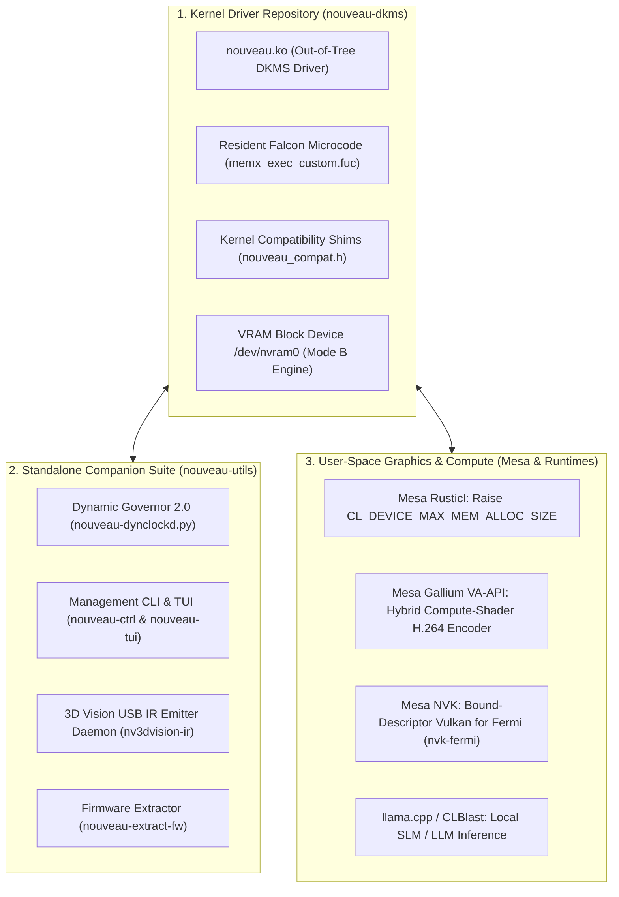

# Roadmap & TODO (`TODO.md`)

This document tracks completed milestones, open engineering tasks, and the multi-architecture roadmap for **`nouveau-dkms`**.

### Documentation Map
- **[`RECLOCKING_NOTES.md`](RECLOCKING_NOTES.md)**: Hardware register tables, Falcon microcode architecture, and decompiled NVIDIA `390.157` (`nv-kernel.o_binary` & `nv-modeset-kernel.o_binary`) specifications.
- **[`research/vram-pooling-and-compression.md`](research/vram-pooling-and-compression.md)**: Research paper on OpenCL 3.0 (`Mesa Rusticl`), quantized SLM execution, Unified `VRAM + GART` memory pooling, and GPU-compressed `nvzram`.
- **[`research/vulkan-on-fermi.md`](research/vulkan-on-fermi.md)**: Architectural analysis of Fermi (`NVC0_3D` / `NVC0_COMPUTE`) bound-descriptor Vulkan 1.0/1.1 feasibility (`nvk-fermi`).
- **[`research/video-encoding-architecture.md`](research/video-encoding-architecture.md)**: Video encoding architecture (`x264` OpenCL, Hybrid Compute-Shader `VA-API` H.264 encoder, Kepler/Maxwell `MSENC`) & PureVideo HD (`VP4`) hardware decode.
- **[`research/stereoscopic-3d-vision.md`](research/stereoscopic-3d-vision.md)**: Active-shutter stereoscopic 3D hardware reference and USB IR emitter protocol.
- **[`CHANGELOG.md`](CHANGELOG.md)**: Release changelog and version history.

---

## Table of Contents
1. [Architectural Overview & Project Separation Blueprint](#architectural-overview--project-separation-blueprint)
2. [Completed Milestones](#completed-milestones)
3. [Kernel & Hardware Subsystems Roadmap](#kernel--hardware-subsystems-roadmap)
4. [Falcon Microcode & Memory Controller Expansion](#falcon-microcode--memory-controller-expansion)
5. [Dynamic Governor Modernization](#dynamic-governor-modernization)
6. [Telemetry, Modern DRM/DRI APIs & Wayland Explicit Sync](#telemetry-modern-drmdri-apis--wayland-explicit-sync)
7. [Compute, VRAM Pooling, Video Firmware & Research](#compute-vram-pooling-video-firmware--research)
8. [Wayland EGL Stability, Full OpenGL 4.3–4.6 Feature Parity & Robust MMU Fault Recovery](#wayland-egl-stability-full-opengl-4346-feature-parity--robust-mmu-fault-recovery)
9. [Project Evolution: nouveau-dkms, Multi-Kernel CI & Cross-Distro Packaging](#project-evolution-nouveau-dkms-multi-kernel-ci--cross-distro-packaging)
10. [Companion Suite (`nouveau-utils`) & Upstream Strategy](#companion-suite-nouveau-utils--upstream-strategy)

---

## Architectural Overview & Project Separation Blueprint

This project strictly separates components requiring direct MMIO register access, hardware interrupt servicing, or kernel DRM hooks (**`nouveau-dkms`**) from companion userspace daemons/CLI tools (**`nouveau-utils`**) and graphics/compute compilers (**`mesa-aliveos`** / upstream Mesa & runtimes).

---

## Completed Milestones

- [x] **`v1.0` — Baseline Fermi Core & Shader Reclocking**:
  - Implemented core and 2× hot-clock shader scaling (`50/101 MHz`, `202/405 MHz`, `590/1180 MHz`).
  - Unlocked 120 Hz eDP display mode (`1920x1080 @ 120 Hz`, pixel clock `396.36 MHz`). *(Zero-flash VBlank transitions tracked in §1 below.)*
- [x] **`v1.1` — Factory Voltage Regulation & State `10` Overclock**:
  - Resolved `0f` VMAP undervolting bug (`870 mV` → factory `1030 mV` / `VID 0x01`).
  - Added and verified synthetic **`10` OC P-State** (`700 MHz` core / `1400 MHz` shader / `900 MHz` DDR3 @ `1.030 V`, **403.2 GFLOPS FP32**, +18.6% compute), gated by `config=NvFermiOC=true`.
- [x] **`v1.2` — Telemetry Suite (`nouveau-ctrl` / `nouveau-tui`) & Dynamic Governor (`nouveau-dynclockd`)**:
  - Built CLI utility [`nouveau-ctrl`](nouveau-ctrl), interactive curses dashboard [`nouveau-tui`](nouveau-tui), and background governor [`nouveau-dynclockd.py`](nouveau-dynclockd.py) with thermal hysteresis protection and Dell SMM fan RPM readout.
- [x] **`v2.0.0` — Full Bidirectional DDR3 Memory Reclocking (`324 MHz` ↔ `900 MHz`)**:
  - Built custom resident Falcon microcode executor (`memx_exec_custom.fuc`) running on `PDAEMON` (`0x10a000`) via MMIO mailboxes (`SCRATCH2`/`SCRATCH3`), bypassing broken Tesla `MEMX` queues.
  - Added hardware DDR3 PHY commit strobe latch (`0x001548 = 0x80000101`) and excluded PMU clock domain `0x0c` from PLL switching (`RECLOCKING_NOTES.md` §8.3), unlocking full **43.2 GB/s** bandwidth (2.78× over boot clock).
- [x] **`v2.0.1` — S3 Suspend/Resume Self-Healing & Dynamic PCIe Gen1 ↔ Gen2 Scaling**:
  - Implemented `SCRATCH0 == 0xE1EC0001` handshake verification in `ramgf100.c` to detect cleared Falcon IMEM after S3 sleep and automatically cold-bootstrap without timeout (`RECLOCKING_NOTES.md` §8.4).
  - Verified automatic PCIe link speed switching between **Gen1 (`2.5 GT/s x16`)** in `03`/`07` and **Gen2 (`5.0 GT/s x16`, `8.0 GB/s`)** in `0f`/`10` (`0x02241c` / `0x088460` / `0x088088`).
- [x] **`v2.1.0` — Kernel `6.18.55` DRM Rebase, Live TTM VRAM Telemetry, Battery Cap & Initial VBlank Wait**:
  - Added `LINUX_VERSION_CODE`-guarded compatibility for the 1-argument `drm_client_dev_suspend()` / `drm_client_dev_resume()` API introduced in Linux `6.18.55` (`nouveau_display.c`).
  - Added exact in-kernel TTM VRAM accounting (`VRAM: <used> MiB / <total> MiB used` on debugfs `pstate`) and unprivileged `/run/nouveau/vram` snapshot for `nouveau-ctrl` and `nouveau-tui`.
  - Added `BATTERY_CAP=true` AC/DC power-supply awareness to `nouveau-dynclockd` (capping to `07` on battery, allowing `0f`/`10` on AC).
  - Added initial host-side `gf100_ram_wait_vblank()` (`NvFermiVblankSync=1`).
- [x] **`v2.2.0` — Zero-Stutter Signed-`vpos` VBlank Memory Reclocking & Zero-Sudo Dynamic Governor**:
  - Implemented true NV50/GF100 signed `vpos` calculation in `ramgf100.c` (`gf100_ram_calc_vpos()` / `gf100_ram_wait_vblank()`), stepping in 80–150 µs sleeps to the 40-line approach zone and tight-polling (`udelay(1)`) the exact VBlank leading edge (`vpos 1077 -> -46`).
  - Removed pre-trigger printk delays and tight-polled resident Falcon completion (`udelay(2)`), latching host `0x001548` DDR3 PHY timing commit in 477–535 µs entirely within VBlank.
  - Added boot-time resident Falcon pre-warm (`cmd = 0`) at 324 MHz in `gf100_ram_calc_ddr3()`.
  - Upgraded `nouveau-dynclockd.py` 2.0 with unprivileged `/run/nouveau/mode` coordination, real-time unprivileged telemetry snapshots, 120 Hz display floor guard (`>= 07`), and `/etc/nouveau-dynclockd.d/*.conf` per-application profiles.
  - Co-located Falcon assembly source `fexec_code.fuc` with `fexec_code.inc` and added `tools/build-fexec.py`.
- [x] **Decompilation of `NVIDIA-Linux-x86_64-390.157` (`nv-kernel.o_binary` & `nv-modeset-kernel.o_binary`)**:
  - Solved the Fermi `PDAEMON` context-switch handshake (`_nv029647rm`), `OBJSEQ` opcode `0x3a` + `0x13d7f4` partition write-buffer flush (`_nv031754rm`), zero-flash `ISOHUB` + in-Falcon `WAIT_VBLANK` (`_nv031916rm`), `0x132004 = 0x10012702` P3 `650 MHz` formula (`_nv010738rm`), and 120 Hz 3D Vision eDP `8 bpc → 6 bpc` step-down (`_nv002219kms`). Documented in [`RECLOCKING_NOTES.md` §10](RECLOCKING_NOTES.md#10-concrete-reverse-engineering-findings-from-nvidia-390157-nv-modeset-kernelo_binary--nv-kernelo_binary).

---

## Kernel & Hardware Subsystems Roadmap

### 1. Eliminating Screen Flashes During Clock Changes (True Zero-Flash VBlank Memory Reclocking)
*(Full hardware specification in [`RECLOCKING_NOTES.md` §10.4](RECLOCKING_NOTES.md#104-nv-kernelo_binary-the-rm-sequencer-objseq--seqscript--memx-bytecode-emitter-api--zero-flash-vblank-pipeline). 390-blob REA: `nv-kernel.o_binary` string-anchored functions `_nv010494rm` (`RmIsoHubMCLKSwitch`), `_nv012821rm` (`RMOnDemandVBlank`), `_nv012818rm` (`RMGlitchlessModeset`, 0xdb5 bytes), `_nv011282rm` (`RmNvsrFlickerControl`), `_nv019868rm` (`RMFermiMinGpmFifoDepth`); static objdump+reloc-xref route, Ghidra not required)*
- [x] **Zero-Stutter Signed-`vpos` VBlank Memory Reclocking (`v2.2.0` / `v2.2.1`)**:
  - Implemented in host-side `ramgf100.c` with signed `vpos` calculation (`gf100_ram_calc_vpos` / `gf100_ram_wait_vblank`), approach-zone micro-sleeps (`80–150 µs`), tight polling the leading edge of VBlank (`vpos == 1077 -> -46`), and host `0x001548` PHY commit latch completing in `470–535 µs` inside VBlank without visual stutter.
- [ ] **Move `WAIT_VBLANK` Inside `memx_exec_custom.fuc` (`< 50 ns` Reaction Latency)**:
  - *(Note: Hardware testing showed Falcon v3 PRIVRING access to display raster registers `0x616340` causes MMIO aborts on GF106. Host-side signed-`vpos` sync in `ramgf100.c` resolved visual stutter completely in `v2.2.0` by landing the entire 477–535 µs reclock inside VBlank. In-Falcon polling remains an architectural research item for chips with PMU PRIVRING apertures).*
- [ ] **Pre-`STOP_FB` Display `ISOHUB` Critical Watermark Spool-Up (`_nv031916rm` / `_nv031860rm`, `_nv010494rm`)**:
  - Boost `ISOHUB` (`0x616300+` / `0x610050`) watermarks to critical force-fill mode before `WAIT_VBLANK` so the display line buffer FIFO is 100% full before DRAM enters Self-Refresh, and restore normal watermarks after `RESTART_FB`. `_nv010494rm` (`.text+0xebac0`, string-xref at `+0xebba7`) is the blob's hub-switch sequencer — disassemble for exact order.
- [ ] **GPM FIFO Minimum-Depth Guard (`_nv019868rm`, `RMFermiMinGpmFifoDepth`)**:
  - Check/program display FIFO watermark depths before retraining (blob uses `$0x700`/`$0x6050`/`$0x100`-class constants); abort-or-defer the reclock if margins are below threshold instead of retraining blindly. Nouveau currently inherits whatever the VBIOS left — thinnest margin is at 120 Hz scanout during retrain.
- [ ] **Treat Glitchless as a Modeset Property (`_nv012818rm`, `RMGlitchlessModeset`)**:
  - Blob sequences display-timing changes through a dedicated state machine that keeps the pipeline fed; our reclock bypasses modeset entirely. Long-term: route MCLK transitions through the atomic commit path instead of firing them from the governor side-channel.
- [ ] **FB Partition Write-Buffer Flush (`0x13d7f4 + (part << 6)`, `_nv031754rm` Opcode `0x3a`)**:
  - Emit the per-partition write-buffer drain after programming PHY DLL registers (`0x10f824`) and before releasing `STOP_FB`. *(Note: GF106 has 3 partitions; writing to non-existent partition 3 `0x13d8f4` causes PRIVRING fault)*.
- [x] **Pre-Warm Falcon Executor at Boot/Resume & Decouple PCIe Retraining**:
  - Pre-warms the resident Falcon executor at initial 324 MHz boot (`gf100_ram_calc_ddr3()`) so runtime P-state changes execute on the sub-millisecond resident fast-path without cold PDAEMON resets. PCIe link retraining ordering is preserved before `calc`.

### 2. Synthetic Intermediate Performance State (P3 / State `0a`)
*(Full derivation in [`RECLOCKING_NOTES.md` §10.5–§10.7](RECLOCKING_NOTES.md#105-nv-kernelo_binary-fermi-mclk--mempll-0x132000--0x132004-reclocking-state-machines))*
- [ ] **Inject Synthetic P3 State `0a` (`405 MHz` Core / `810 MHz` Shader / `650 MHz` DDR3 @ `0.920 V`)**:
  - **DDR3 `650 MHz` (`31.2 GB/s`) in `ramgf100.c` & `memx_exec_custom.fuc`**: Because `650 MHz` exceeds both the `405 MHz` and `500 MHz` thresholds in `_nv014883rm`, reuse the `900 MHz` VBIOS strap sequence with **`0x132004 = 0x10012702`** ($M=2, N=39, P=1$).
  - **Voltage Mapping (`VID 0x03`)**: Map P-state `0a` (`config=NvFermiP3=true`) to hardware VID `0x03` (`0.920 V`, ~18–22 W) in `nvkm_pstate_new()`.

### 3. 120 Hz 3D Vision eDP Display Pipeline & Stereoscopic 3D Support
*(Full decompilation in [`RECLOCKING_NOTES.md` §10.2](RECLOCKING_NOTES.md#102-nv-modeset-kernelo_binary-120-hz-3d-vision-edp-validation--automatic-dp-bpc-step-down))*
- [ ] **Automatic DP/eDP BPC Step-Down (`8 bpc` → `6 bpc`) & EDID `+5.0 MHz` Grace Margin**:
  - In `dispnv50` / `nouveau_connector.c`, automatically step down `bpc` from `8` (`24 bpp` = `9.51 Gbps > 8.64 Gbps` HBR1 limit) to **`6 bpc` (`18 bpp` = `7.13 Gbps <= 8.64 Gbps`)** with spatial/temporal dithering when `mode->clock * 24 > dp_link_bw` (matching `_nv002219kms`).
  - Grant the `+5.0 MHz` pixel-clock tolerance and ignore self-contradicting EDID range descriptors on 3D Vision panels (`LGD 0x02c5`, matching `_nv000659kms`).
  - Enforce a kernel-side minimum P-state floor of `07` (`dispclk = 405 MHz`) whenever active `pixel_clock > 135,000 kHz` (matching `_nv002187kms` IMP check).
- [ ] **Stereoscopic 3D (`NVIDIA 3D Vision`) Support (`LGD 0x02c5` + Internal USB IR Emitter `0955:0007`)**:
  - Trace EVO stereo head registers (`0x61xxxx`) in `nv-modeset-kernel.o_binary` and build a lightweight `nv3dvision-ir` helper synchronizing the built-in USB IR emitter (`0955:0007`) with `DRM_IOCTL_WAIT_VBLANK` at 120 Hz (`60 Hz` per eye) for `bino`, `mpv`, and quad-buffered stereo.

### 4. Fermi Engine Clock-Gating (BLCG / SLCG) & Hardware Load Counters (`0x10a600`)
*(Documented in [`RECLOCKING_NOTES.md` §10.3 & §10.8](RECLOCKING_NOTES.md#108-how-390157-handles-dynamic-reclocking-powermizer-vs-nouveau-dynclockd))*
- [ ] **Extract & Program Fermi BLCG / SLCG Clock-Gating Tables**:
  - Extract the static per-chip Block-Level and Second-Level Clock Gating tables from `.rodata` in `nv-kernel.o_binary` for `GF100`–`GF119` and program them during `gr`, `fb`, `copy`, and `therm` init to cut idle power by `2–4 W`.
- [ ] **Hardware GPU Engine Utilization Counters (`0x10a600..0x10a610`, `_nv029625rm` / `_nv029628rm`)**:
  - Decompile `_nv029625rm` (`0x515a70`) and `_nv029628rm` (`0x515ad0`) to extract the exact signal masks for `GR %`, `FB %`, and `VDEC %` busy counters in `PDAEMON` and expose them via debugfs/sysfs.

### 5. Closing the Performance Parity Gap with NVIDIA 390.157 (The Final 15–25%)
*(Full technical analysis: With core/shader (`590/1180 MHz`), DDR3 memory (`900 MHz`), and PCIe Gen2 (`5.0 GT/s x16`) reclocking operating at 100% silicon parity in `v2.2.0`, the remaining performance gap against NVIDIA's proprietary driver stems from raster tile compression, superscalar shader dispatch, and dynamic clock gating. Userspace `nv50_ir` / Gallium compiler and shader items have moved to [`Twilight0/mesa-aliveos`](https://github.com/Twilight0/mesa-aliveos/blob/main/TODO.md).)*
- [ ] **Kernel `TAGRAM` Allocation for Z-Cull & Tile Depth Compression (`PLTCG` `0x140000` / `PGRAPH`)**:
  - Audit and decompile `_nv010721rm` / `_nv031754rm` (`objseq` raster config) so the kernel allocates and exposes `TAGRAM` backing buffers for userspace Mesa (`mesa-aliveos`) to bind Z-Cull and ROP color tile compression tags.
- [ ] **Hardware `PTHERM` Auto-Slowdown (`0x00020xxx`) & Progressive Multi-Step Thermal Throttling**:
  - Because the non-Optimus Dell XPS L702X cools both the Intel CPU and NVIDIA GT 555M with a **single shared blower fan**, program hardware `PTHERM` clock-slowdown failsafes at `90–92 °C` and implement progressive governor step-down (`10` → `0f` at `78 °C` → `0a` at `82 °C` → `07` at `86 °C`).
- [ ] **Fine-Grained BLCG / SLCG Hardware Clock Gating (`0x00020xxx`)**:
  - Extract `.rodata` tables from `nv-kernel.o_binary` and program them during `gr`/`fb`/`therm` init, cutting idle leakage by `2–4 W` and providing dynamic power/thermal headroom so the core maintains maximum boost frequency without thermal throttling.

### 6. Hardware Quirk & Device Profile Database (`quirks.h`)
- [x] **Unified `quirks.h` Subsystem Table (`include/nvkm/core/quirks.h` & `0005` patch)**:
  - Implemented PCI Subsystem ID (SSID) quirk subsystem matching vendor and device IDs (`pdev->subsystem_vendor` / `pdev->subsystem_device`).
  - Added initial quirk profiles for Dell XPS 17 L702X (`1028:04b7`), ASUS K53SJ Optimus muxless (`1043:xxxx`), Sony VAIO VPCEH18FA (`104d:908b`), Lenovo ThinkPad T520 (`17aa:21d1`), Dell Latitude E6430 (`1028:1534`), EVGA GTX 560 (`3842:1461`), and Lenovo ThinkPad W510 (`17aa:2145`).
  - Guarded VBlank sync and unclocked display engine access via `NOUVEAU_QUIRK_OPTIMUS_MUXLESS` in `ramgf100.c` to resolve bus lockups on muxless hybrid laptops (Issue #7).

---

## Falcon Microcode & Memory Controller Expansion

- [ ] **Two-Tier Universal Fermi DDR3 Reclocking (Issue #46 — `GF108`, `GF119`, etc.)**:
  - **Tier 1 — Safe Non-GF106M Fallback & Perf `v0x40` Discovery (`v2.3.5`)**:
    - Parse VBIOS Performance Table `v0x40` (`perfS.v40.freq` for `nv_clk_src_mem`) alongside `v0x25`–`v0x3f` in `gf100_ram_init()` so `ddr3_lo`/`ddr3_hi` reflect the board's actual VBIOS clocks (e.g. `405/500 MHz` on `GF108` instead of falling back to `324/900 MHz`).
    - Move the "already at target" check before validation in `gf100_ram_calc_ddr3()`, and gate `gf100_ram_exec_custom()` strictly to boards/clocks with a verified native Falcon script (`GF106` `324/900 MHz` until Tier 2). On all other Fermi DDR3 boards/clocks, log once cleanly and return `0` leaving DRAM at its current clock so core, shader, and voltage P-states (`07`, `0f`, `10`) transition with zero `-EINVAL` (`-22`) errors.
  - **Tier 2 — VBIOS-Parameterized Falcon DMEM Executor (`v2.4.0`)**:
    - Replace hardcoded `GF106M` `324/900 MHz` constants inside `fexec_code.fuc` with a Falcon DMEM parameter struct populated by `gf100_ram_calc()` from each board's own VBIOS (`Timing`, `Timing Mapping`, `PLL limits`, `MEM TYPE`, and `MR0–MR3` `0x10f300..0x10f30c`).
    - Leverage community hardware reports from GitHub Discussions (`#39` `GF108` GT 730, `#40` `GF108M` GT 540M, `#41` `GF108M` GT 630M, `#34`/`#37`/`#32` `GF119M` 410M/520M/610M) to populate `include/nvkm/core/quirks.h` (`NOUVEAU_QUIRK_DDR3_1PARTITION` vs `3PARTITION`, verified SSIDs in `pci.c`) and validate `GF106M` (`324 <-> 900 MHz`) parity before testing `GF108` (`405 <-> 500 MHz`) and `GF119M` (`405 <-> 800 MHz`).
- [ ] **Generalize Falcon Executor Across All Fermi Chips (`GF100`–`GF119`)**:
  - Decouple GF106-specific DDR3 offsets in `ramgf100.c` using the per-family RM emitters (`_nv015935rm` GF100, `_nv015936rm` GF104/GF106, `_nv015937rm` GF108, `_nv015938rm` GF119) and partition unicast/broadcast mapper `[pFb + 0xd20]` (`_nv016234rm`) supporting 64-bit to 384-bit buses.
- [ ] **Fermi GDDR5 Timing & Training Engine (`_nv010721rm` / `_nv010722rm`)**:
  - Extract the GDDR5 branches of `_nv010721rm` (`0xec6b0`) and `_nv010722rm` (`0x104470`) to support GDDR5 Fermi cards (GT 555M GDDR5, GTX 460/470/480, GTX 560 Ti/570/580).

---

## Dynamic Governor Modernization

- [ ] **Replace `/proc` CPU-Tick Scanning with Hardware GPU Load Counters (`0x10a600..0x10a610`)**:
  - Replace `get_monitored_app_ticks()` `/proc` scanning with a single `< 0.05 ms` read of hardware `GR %`, `FB %`, and `VDEC %` utilization counters. *(Hardware interrupt delta tracking implemented in `v2.2.0` via `/proc/interrupts` `nvkm`)*.
- [x] **120 Hz Display-Aware Idle Floor (`>= 07`)**:
  - Automatically clamp `IDLE_STATE` to `07` (`405 MHz` `dispclk`, `324 MHz` DDR3) when a `> 135 MHz` pixel-clock mode (120 Hz) is active, dropping to `03` only at 60 Hz or DPMS off.
- [x] **5-Tier Scaling Ladder (`03` ↔ `07` ↔ `0a` ↔ `0f` ↔ `10`) with Hold-Down Timers**:
  - Scale across all 5 states based on hardware `GR`/`FB`/`VDEC` load with `5–8 s` PowerMizer-style hold-down timers so brief loading screens never trigger mid-game memory reclocks.
- [x] **Manual Override Coordination (`/run/nouveau/mode`)**:
  - Coordinate `nouveau-ctrl set <pstate>` and `nouveau-tui` with `nouveau-dynclockd` via `/run/nouveau/mode` (`locked:<pstate>` vs `auto`) so manual locks are not overwritten on the next daemon poll while retaining thermal runaway protection.
- [x] **Event-Driven Wakeups & Per-Application Profiles (`/etc/nouveau-dynclockd.d/`)**:
  - Support netlink/udev power-supply events and per-app P-state rules (Steam/Proton → `0f`/`10`, MPV/VLC → `07`/`0a`, OBS → `0a`/`0f`).

---

## Telemetry, Modern DRM/DRI APIs & Wayland Explicit Sync

- [ ] **Standard Linux DRM `drm_show_fdinfo` (`nvtop` / `btop` / `MangoHud` Support)**:
  - Wire `drm_driver.show_fdinfo` in `nouveau_drm.c` to export per-client `drm-memory-vram`, `drm-memory-gtt`, `drm-engine-gfx`, `drm-engine-dec`, and `drm-engine-dma`.
- [ ] **Unprivileged `sysfs` Telemetry (`gpu_busy_percent`, `mem_info_vram_used`, `mem_info_vram_total`)**:
  - Expose standard DRM `sysfs` attributes under `/sys/class/drm/card*/device/` so monitoring tools and `nouveau-ctrl`/`nouveau-tui` work without root or debugfs workarounds.
- [ ] **Real-Time ASCII Sparklines & Power Estimation ($P_{est}$) in `nouveau-tui` / `nouveau-ctrl watch`**:
  - Render 60-second scrolling sparklines (` ▂▃▄▅▆▇█`) and estimated Watt dissipation (`03`: ~4.2 W, `07`: ~8.5 W, `0a`: ~19.5 W, `0f`: ~38.0 W, `10`: ~46.5 W).
- [ ] **Wayland Explicit Sync (`linux-drm-syncobj-v1` / `drm_syncobj`) & Atomic Async Page-Flip (`DRM_MODE_PAGE_FLIP_ASYNC`)**:
  - Validate `drm_syncobj` timeline fences and enable atomic async page-flips on `dispnv50` (`wndw.c` / `head.c`) for tear-free 120 Hz Wayland pacing and unthrottled benchmarking.

---

## Compute, VRAM Pooling, Video Firmware & Research

*(Userspace Mesa `Rusticl`, `VA-API` compute-shader H.264 encoder, and `nvk-fermi` Vulkan tasks have moved to [`Twilight0/mesa-aliveos`](https://github.com/Twilight0/mesa-aliveos/blob/main/TODO.md). Below are the remaining kernel-side and research items.)*

- [ ] **Unified `VRAM + GART` AI Inference & GPU-Compressed `nvzram` ([`research/vram-pooling-and-compression.md`](research/vram-pooling-and-compression.md))**:
  1. Implement Mode A (`TTM_PL_VRAM | TTM_PL_TT` transparent oversubscription + `PCOPY` layer prefetching) for `> 3 GiB` LLMs.
  2. Implement Mode B (`/dev/nvram0` `PCOPY1` DMA-backed upper-VRAM block device with automatic 3D/AI balloon eviction).
  3. Implement **`nvzram`** (`PCOPY0` batch DMA + `NVC0_COMPUTE` `SM20` Warp-LZ4 compression inside VRAM storing `~6.0–7.5 GiB` of compressed RAM in `2.5 GiB` VRAM, with `< 0.6 µs` compressed-DMA single-page `swapin`).
- [ ] **Video Firmware (`VP4` Decode) & `MSENC` Hardware Enablement ([`research/video-encoding-architecture.md`](research/video-encoding-architecture.md))**:
  1. Ship `nouveau-extract-fw` (in `nouveau-utils`) to extract PureVideo HD `VP4` decode firmware (`nv98_fuc084/085/086`) from `390.157`.
  2. Reverse-engineer Kepler (`GK104+`) & Maxwell (`GM107+`) fixed-function `MSENC` (`0x1c8000`) kernel/firmware initialization for `VA-API` H.264 encoding in `mesa-aliveos`.
- [ ] **`llama.cpp` / `CLBlast` OpenCL Acceleration**:
  - Build and tune `llama.cpp` with `-DGGML_OPENCL=ON` for Small Language Models (SLMs) on Fermi.

---

## Wayland EGL Stability, Full OpenGL 4.3–4.6 Feature Parity & Robust MMU Fault Recovery

*(Thorough investigation via REA, decompilation of `nv-kernel.o_binary` / `libnvidia-glcore.so.390.157`, Khronos conformance verification, and hardware trap tracing on GF106/Fermi)*

### Hardware Architecture: Fermi Silicon is Fully OpenGL 4.6 Capable
A critical finding from decompiling NVIDIA's official legacy production driver (`390.157`) and reviewing Khronos conformance specifications is that **Fermi hardware (`GF100`–`GF119`) physically supports the complete OpenGL 4.6 feature set**:
* **Khronos Compatibility**: The OpenGL 4.6 specification is designed to be fully backward-compatible with any GPU that supports OpenGL 4.5.
* **Proprietary Driver Proof**: NVIDIA driver `390.157` officially exposes `OpenGL 4.6.0 (NVIDIA 390.157)` and `GLSL 4.60` on Fermi chips under both Linux and Windows.
* **Hardware Capabilities Present in Silicon**:
  1. **Native FP64 Arithmetic**: Hardware double-precision floating point units in SM20.
  2. **Indirect Multi-Draw Execution**: Hardware draw parameter streaming (`GL_ARB_indirect_parameters`).
  3. **Direct State Access (DSA)**: Full object and framebuffer manipulation without target binding.
  4. **Hardware Polygon Offset Clamp**: Native slope and depth clamping in rasterizer class `9097`.
  5. **Atomic Counters & Subgroup Operations**: Native atomic ops on global/shared memory (`GL_ARB_shader_atomic_counter_ops`, `GL_ARB_shader_group_vote`).
  6. **SPIR-V Intermediate Representation (`GL_ARB_gl_spirv`)**: Purely a driver compiler ingestion layer (translating SPIR-V bytecode into Fermi machine code), requiring no new physical hardware logic.

Modern heavy desktop and 3D applications (e.g. Blender 4.0+, modern browsers, and Wayland compositors) expose edge cases in the open-source Nouveau stack that do not trigger under legacy OpenGL 3.3 workloads:
1. **`EGL Error (0x3009): EGL_BAD_MATCH`**: Blender queries Wayland EGL for 10-bit color (`RGB10_A2`), 16-bit float surfaces (`EGL_COLOR_COMPONENT_TYPE_FLOAT_EXT`), and sRGB buffers. Mesa's Wayland platform fails visual matching on Fermi due to absent HDR/float scanout modifiers, spamming bad match errors.
2. **`DATA_ERROR 00000004 [INVALID_VALUE]` on Method `0x0804`**: Class `9097` (`GF100_3D`) method `0x0804` (`NV9097_SET_COLOR_TARGET_B(0)`) requires render target base addresses to be aligned to **256 bytes (`0x100`)**. Passing suballocated or unaligned offsets (e.g. `0x03c9b908`, 8-byte aligned) trips hardware validation.
3. **`GPC0/TPC1/MP trap: warp [OOR_ADDR]` & `fifo: fault [PT_NOT_PRESENT]`**: Blender 4.x UI and viewport rendering dispatch OpenGL compute shaders (`PIPE_SHADER_COMPUTE`). Because Fermi lacks Kepler-style native hardware SSBO descriptors, Mesa lowers SSBO pointer arithmetic to 64-bit integer calculations. Unchecked buffer offsets or sign extensions wrap to non-canonical addresses (e.g. `0x000000a7da7c4000`), triggering an out-of-range address (`OOR_ADDR`) hardware warp trap and MMU page-table miss.
4. **Catastrophic Channel Recovery (`nvkm_runl_rc_cgrp`)**: In `nvkm/engine/fifo/gf100.c`, Nouveau responds to any MMU fault by unconditionally killing the client channel (`channel killed!`). Subsequent pushbuf submissions return `ENODEV` (`nouveau: kernel rejected pushbuf: No such device`), immediately crashing the application with `SIGSEGV` instead of isolating the fault.
5. **`mesa_glthread=true` Pushbuf Races**: Asynchronous multi-threaded command batching in Mesa triggers pushbuf reordering and race conditions on Nouveau, worsening buffer alignment and sync faults.

### Full OpenGL 4.3–4.6 Specification & Feature Parity Roadmap (Kernel vs. Mesa)

*(Userspace Mesa tasks for `nv50_ir` SSBO bounds clamping, `nvc0_surface.c` alignment, `platform_wayland.c` EGL visual fallback, `drirc`, and OpenGL 4.5–4.6 / `nvk-fermi` / Zink extensions have moved to [`Twilight0/mesa-aliveos`](https://github.com/Twilight0/mesa-aliveos/blob/main/TODO.md). Below are the remaining kernel-side tasks in `nouveau-dkms`.)*

### Actionable Kernel-Side Fixes & Implementation Tasks

- [ ] **Kernel: Non-Fatal MMU Fault Isolation & Engine Soft-Reset (`nvkm/engine/fifo/gf100.c` & `nvkm/engine/gr/gf100.c`)**:
  - **Decompilation Reference**: `nv-kernel.o_binary` exports `rm_gpu_ops_service_device_interrupts_rm` and `_nv007827rm` / `_nv007800rm` error containment. When a warp trap occurs, the NVIDIA proprietary driver resets the execution unit pipeline, drops the offending batch, and logs the error without unbinding the user channel.
  - **Task**: In `gf100_fifo_mmu_fault_recover()` and `gf100_gr_trap_mp()`, replace unconditional `nvkm_runl_rc_cgrp(chan->cgrp)` channel killing with a recoverable soft-reset pipeline:
    1. Issue an engine pipeline reset (`0x400500` / `0x400800` PGRAPH flush).
    2. Clear TPC MP error registers (`0x648` / `0x650`).
    3. Drop/skip the failing compute dispatch packet, signal the sync fence with `-EIO`, and return control to userspace.
    4. Implement fault rate-limiting: only escalate to a hard channel kill if more than $N$ faults occur within a 1-second window.
- [ ] **Kernel: Shared Read-Only Zero-Page Virtual Address Fallback (`vmmgf100.c`)**:
  - In `nvkm/subdev/mmu/vmmgf100.c`, map unallocated userspace GPU virtual address ranges to a shared read-only zero page instead of leaving page table entries unpopulated (`PT_NOT_PRESENT`). Out-of-bounds shader reads will return `0.0f` rather than triggering a fatal hardware MMU fault, matching modern GPU fault-tolerant memory behavior.
- [ ] **Kernel: Color Target 256-Byte (`0x100`) Base Alignment Enforcement (`nouveau_bo.c` / `nouveau_gem.c`)**:
  - Enforce strict `ALIGN(offset, 256)` in `nouveau_bo.c` / `nouveau_gem.c` for all render target base addresses sent to method `0x0804` (`NV9097_SET_COLOR_TARGET_B`) (paired with Mesa-side enforcement in `mesa-aliveos`), eliminating PGRAPH `DATA_ERROR 00000004 [INVALID_VALUE]` on suballocated surfaces.

---

## Project Evolution: nouveau-dkms, Multi-Kernel CI & Cross-Distro Packaging

Because upstream Linux's new Rust driver (`Nova`) exclusively supports Turing (`NV160+`) and newer GSP-based GPUs while upstream `nouveau` is in maintenance freeze for pre-Turing silicon, this project serves as **`nouveau-dkms`**—an actively maintained out-of-tree DKMS driver and compute stack covering all **pre-`Nova` NVIDIA architectures**:

| Generation | Chip Families | GeForce Series | Firmware Security | `nouveau-dkms` Target Roadmap |
| :--- | :--- | :--- | :---: | :--- |
| **Fermi** (`NVC0`–`NVCF`) | `GF100`–`GF119` | GeForce 400 / 500 / 600M–800M | **Unsigned Falcon** | **Working on GF106 (`v2.2.0+`)**. Expand DDR3/GDDR5 tables, BLCG/SLCG, P3 (`0a`), and zero-flash VBlank to all `GF100`–`GF119` chips. |
| **Kepler** (`NVE0`–`NV108`) | `GK104`–`GK208` | GeForce 600 / 700 / 800M | **Unsigned Falcon** | Add automatic governor support, GPU Boost 1.0/2.0 interpolation, mobile `GK107M`/`GK208M` RAM fixes, and `MSENC` (`0x1c8000`) VA-API encode. |
| **Maxwell 1** (`NV117`–`NV118`) | `GM107`–`GM108` | GTX 750 / 750 Ti, GTX 850M–960M, MX110/MX130 | **Unsigned Falcon!** | **High-Value Target**: First-gen Maxwell has **no signed PMU lockdown** and is fully supported in `390.157`! Port custom Falcon PMU + PLL/RAM reclocking to `GM107`/`GM108`. |
| **Tesla** (`NV50`–`NVA8`) | `G80`–`GT218` | GeForce 8000 / 9000 / 200 / 300 | **Unsigned** | Stabilize `GT215`–`GT218` PDAEMON/host reclocking and integrate `nouveau-dynclockd`. |
| **Maxwell 2 & Pascal** (`NV120`–`NV138`) | `GM200`–`GP108` | GeForce GTX 900 & GTX 10-series | **HS RSA-Signed ACR/PMU** | Investigate extracting signed PMU/ACR images from official redistributables + unified governor and `fdinfo` telemetry. |

### Out-of-Tree Maintenance, Multi-Kernel CI & Cross-Distro Packaging Tasks
- [x] **Deconstruct Monolithic `nouveau.patch` into a Modular Multi-Generation Patch Queue (`patches/`)**:
  - Organized the patch series into tiered, logical series ranges:
    - **`0001`–`0009` — Universal Subsystem Improvements (All Architectures)**:
      - `0001-drm-nouveau-bo-enforce-256b-alignment.patch` (Fermi+ color target hardware alignment in `nouveau_bo.c` / `nouveau_gem.c`)
      - `0002-drm-nouveau-ttm-vram-accounting-debugfs.patch` (In-kernel TTM VRAM usage reporting in `nouveau_debugfs.c`)
      - `0003-drm-nouveau-display-120hz-and-backlight.patch` (High-refresh 120 Hz view preservation in `dispnv50/disp.c`)
      - `0004-drm-nouveau-compat-shims.patch` (`nouveau_compat.h` multi-kernel compatibility layer)
    - **`0010`–`0019` — Fermi (`GF100`–`GF119`) Reclocking & VBlank Synchronization**:
      - `0010-drm-nouveau-fermi-core-shader-pstates.patch` (`clk/base.c`, `clk/gf100.c`)
      - `0011-drm-nouveau-fermi-pdaemon-fuc3-bootstrap.patch` (`pmu/fuc/gf100.fuc3.h`, `pmu/memx.c`, `pmu/gt215.c`)
      - `0012-drm-nouveau-fermi-resident-falcon-ddr3-vblank.patch` (`ramgf100.c` zero-tear approach-zone VBlank synchronization)
    - **`0020`–`0029` — Kepler (`GK104`–`GK208`) Reclocking & Hardware Boost**:
      - `0020-drm-nouveau-kepler-pstate-tables.patch` (`clk/gk104.c`, `clk/gk20a.c`)
      - `0021-drm-nouveau-kepler-ram-timings.patch` (`fb/ramgk104.c` mobile `GK107M`/`GK208M` DDR3 fix bypassing GDDR5 link training)
    - **`0030`–`0039` — Maxwell 1 (`GM107`–`GM108`) Reclocking (Unsigned PMU)**:
      - `0030-drm-nouveau-maxwell1-pmu-falcon.patch` (`pmu/gm107.c`, `clk/gm107.c`, `fb/ramgm107.c`)
    - **`0040`–`0049` — Tesla (`GT215`–`GT218`) PDAEMON Reclocking**:
      - `0040-drm-nouveau-gt215-pdaemon-clk.patch` (`clk/gt215.c`, `fb/ramgt215.c`)
  - **Generation Isolation & Portability**:
    - Universal patches apply cleanly across all GPUs.
    - Generation-specific patches touch isolated subdev paths (`clk/gk104.c` vs `clk/gf100.c`, `fb/ramgk104.c` vs `fb/ramgf100.c`), ensuring changes to one generation can never regress or conflict with another.
    - Enables testing and rolling out support for new silicon (such as Kepler or Maxwell 1) independently without touching tested Fermi production code.
- [x] **Centralized Multi-Kernel Compatibility Header (`nouveau_compat.h`)**:
  - Consolidated all `LINUX_VERSION_CODE` API wrappers (including Linux `6.18.55` `drm_client_dev_suspend()` argument change and `7.0`..`7.3+` TTM/DRM-scheduler shifts) into a single `nouveau_compat.h` header.
  - Allows the same unified driver tree to compile out-of-tree without modifications across `6.18 LTS`, `7.2` Arch, and `7.3` CachyOS Clang.
- [x] **Multi-Generation Chip Matrix Builder (`tools/nouveau-matrix-builder.py` & `testing/test-kernel-matrix.sh`)**:
  - Automated builder supporting generation profiling (`universal`, `fermi`, `kepler`, `maxwell1`, `tesla`, `all`).
  - Implements `--check-isolation`, standalone monolithic patch synthesis (`--build-patch <gen>`), independent tree construction (`--build-tree <gen>`), and 2D compilation testing against installed kernels.
  - Accommodates Kepler and Maxwell 1 "hybrid" V/F Boost reclocking curves and mobile DDR3 bypass (detailed in `RECLOCKING_NOTES.md` §11).
- [ ] **Upstream Ingestion & Dual-Branch Tracking Workflow (Transition to Owned C Source Tree)**:
  - Move from the `nouveau-source.tar.gz` + `patches/` + `nouveau.patch` patch-stack model to an owned, git-tracked C source tree under `src/`:
    1. **Unpack into `src/` with an `upstream` branch**:
       - Maintain an `upstream` branch containing *only* vanilla `drivers/gpu/drm/nouveau` under `src/` (seeded from `nouveau-source.tar.gz`).
       - On `master`, bring in `upstream` and replay `0001`–`0015` as individual commits so `git log` and `git blame` preserve each feature cleanly.
       - Keep `0004` in-tree via `src/nouveau_compat.h` (`LINUX_VERSION_CODE` guards) so multi-kernel DKMS continues to work out of the box.
    2. **Simplify Build & Packaging**:
       - Update `Makefile` (`src-prep` / `install`) to build directly from `src/` instead of untarring `nouveau-source.tar.gz` and applying `patches/series`.
       - Update `PKGBUILD` and `.SRCINFO` to drop `nouveau-source.tar.gz` and `nouveau.patch`.
       - Remove `nouveau-source.tar.gz`, `nouveau.patch`, and `patches/` (full patch history remains in git).
    3. **Update CI & Upstream Sync**:
       - Update `testing/test-kernel-matrix.sh` and `.github/workflows/` to run the multi-kernel compile matrix directly against `src/`.
       - Add a `tools/sync-upstream.sh <linux-tag>` helper to update the `upstream` branch from `drivers/gpu/drm/nouveau` so future kernel syncs are a single `git merge upstream` (no force-pushing `master`).
- [x] **GitHub Actions Multi-Kernel DKMS CI Test Pipeline (`.github/workflows/ci-kernel-matrix.yml`)**:
  - Automated CI workflow triggered on push, PR, and weekly schedule that verifies patch application, compiles `nouveau.ko` out-of-tree across 8 active modern distribution targets: Arch `linux-lts` (6.18 LTS), Arch `linux` (7.2+ Mainline), CachyOS `linux-cachyos` (7.3+ / Clang `LLVM=1`), Fedora latest (`kernel-devel`), Ubuntu 26.04 LTS / Rolling (`linux-headers-generic`), Ubuntu 24.04 LTS / Linux Mint 22 HWE (`linux-headers-generic-hwe-24.04`), Debian Testing (`linux-headers-amd64`), and openSUSE Tumbleweed (`kernel-default-devel`), and packages `.deb`, `.rpm`, and `.pkg.tar.zst` artifacts.
- [x] **Community Triage & Workflow Shift (Discussions vs. Issues)**:
  - Transitioned the community triage model: raw hardware diagnostic dumps and general compatibility tests are routed to GitHub Discussions (e.g. dedicated compatibility threads), freeing the GitHub Issue tracker strictly for actionable bug reports, panics, and regressions.
  - Subsystem IDs and board-level findings reported in Discussions are triaged and ingested into `include/nvkm/core/quirks.h`.
  - Updated `docs/CONTRIBUTING.md` and issue templates to reflect the strict issue reporting scheme.
- [x] **Package Rename / Transition (done: `nouveau-dkms`, was `nouveau-fermi-reclock-dkms`)**:
  - `PKGBUILD` carries `provides=('nouveau-fermi-reclock-dkms')`, `conflicts=('nouveau-fermi-reclock-dkms' 'nouveau-fermi-reclock-cachyos-lts-v2')`, `replaces=('nouveau-fermi-reclock-dkms')` so the old AUR package and prebuilt upgrade cleanly. Completed on AUR and AliveOS repository.
- [x] **Codebase Decoupling (`nouveau-dkms` & `nouveau-utils`)**:
  - Decoupled monolithic repository into pure kernel driver (`nouveau-dkms`) and standalone userspace governor/CLI/TUI suite (`nouveau-utils`).
  - History preserved cleanly via `git-filter-repo`.
  - Independent versioning and releases starting at `v2.2.0` / `v2.2.1`.
- [x] **Cross-Distribution Packaging & GitHub Actions CI Pipelines**:
  1. **Arch Linux (`.pkg.tar.zst`)**: Standalone `PKGBUILD` + `.SRCINFO`, tested and published on AUR (`nouveau-dkms`, `nouveau-utils`) and `aliveos-repo`.
  2. **Debian / Ubuntu (`.deb`)**: Standalone `packaging/debian/` and `build-deb.sh` producing clean architecture-independent `.deb` packages.
  3. **Fedora / RHEL (`.rpm`)**: Standalone `.spec` files producing `.noarch.rpm` packages.
  4. **Automated CI Matrix (`.github/workflows/package-and-release.yml`)**: Continuous multi-distro containerized packaging pipeline building and publishing release assets on every tag.
- [ ] **Universal Distro-Agnostic `Makefile` (`sudo make dkms-install`)**: Fallback source installer for any Linux distribution.
- [ ] **Gentoo (`sys-kernel/nouveau-dkms` ebuild)** & **NixOS (`flake.nix` kernelModulePackage + NixOS service module)**.

---

## Companion Suite (`nouveau-utils`) & Upstream Strategy

### Companion User-Space Utilities (`Twilight0/nouveau-utils`)
User-space tools are decoupled into [Twilight0/nouveau-utils](https://github.com/Twilight0/nouveau-utils) with independent releases and cross-distribution packaging (AUR, `.deb`, `.rpm`, `aliveos-repo`):
- [x] `nouveau-dynclockd.py` 2.0 (hysteresis hold timers, 120 Hz display floor, `/run/nouveau/mode` zero-sudo coordination, `/etc/nouveau-dynclockd.d/*.conf` per-app profiles, `/proc/interrupts` delta tracking, `/run/nouveau/` telemetry snapshots).
- [x] `nouveau-ctrl`, `nouveau-tui`, and `tools/nouveau-fermi-diag.py`.
- [ ] Hardware engine counter sampling (`0x10a600..0x10a610`) and 5-tier ladder completion with synthetic P3 state `0a`.
- [ ] Real-time ASCII sparkline activity history in `nouveau-tui` and `nouveau-ctrl watch`.
- [ ] `nv3dvision-ir` USB emitter synchronization daemon (`0955:0007`) and `nouveau-extract-fw` PureVideo HD / MSENC firmware extractor.

### Upstream User-Space Strategy (`Twilight0/mesa-aliveos`)
All Mesa `nvc0` / `nv50_ir` / `Rusticl` / `VA-API` / `nvk-fermi` tasks are tracked in [`mesa-aliveos/TODO.md`](https://github.com/Twilight0/mesa-aliveos/blob/main/TODO.md). When upstream acceptance for legacy hardware patches is uncertain:
1. **Downstream Custom Package (`aliveos-repo`)**: Maintain targeted `patches/` in `mesa-nouveau-enhanced` / `mesa` `PKGBUILD` so users receive capabilities via standard package updates.
2. **Overlay Library Prefix (`/opt/nouveau-enhanced/`)**: Test isolated Mesa builds via `LIBVA_DRIVERS_PATH`, `VK_ICD_FILENAMES`, and `/etc/OpenCL/vendors/` without replacing system Mesa.
3. **Upstream Draft / RFC MRs**: Open draft Merge Requests on `gitlab.freedesktop.org/mesa/mesa` for public visibility, CI validation, and easy cherry-picking.
